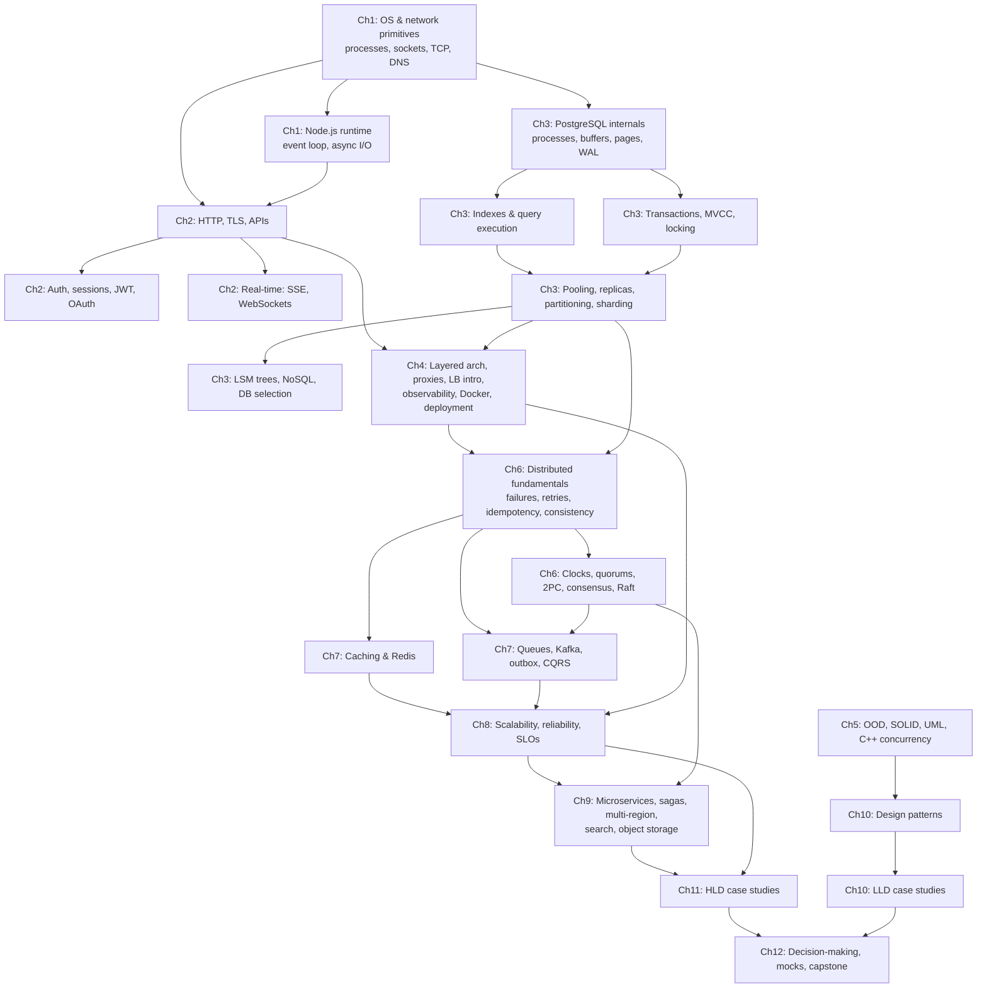

# System Design Mastery — Course Roadmap

> Master plan for a ~7-month, ~380-hour programme covering backend engineering, database engineering, distributed systems, High-Level Design (HLD), Low-Level Design (LLD) and technical interview preparation.
>
> Companion documents: [`progress-tracker.md`](./progress-tracker.md) (live status) · each chapter's `chapter-roadmap.md` (detailed plan, written at the start of that chapter).

---

## Table of Contents

1. [Course Parameters](#1-course-parameters)
2. [Changes to the Original Curriculum](#2-changes-to-the-original-curriculum)
3. [Depth Tiers](#3-depth-tiers)
4. [Dependency Map](#4-dependency-map)
5. [Week-by-Week Schedule](#5-week-by-week-schedule)
6. [Chapter-wise Teaching Units — HLD / Backend Track](#6-chapter-wise-teaching-units--hld--backend-track)
7. [Chapter-wise Teaching Units — LLD Track](#7-chapter-wise-teaching-units--lld-track)
8. [The Running Project](#8-the-running-project)
9. [Interview Critical Path](#9-interview-critical-path)
10. [Expected Outcomes per Month](#10-expected-outcomes-per-month)
11. [Repository Conventions](#11-repository-conventions)
12. [Repository Structure and Scaffold Script](#12-repository-structure-and-scaffold-script)

---

## 1. Course Parameters

### 1.1 Time budget

| Item | Value |
|---|---|
| Daily commitment | ~2 hours |
| Planned duration | **30 weeks (~7 months)** |
| Nominal hours | 30 × 7 × 2 = 420 h |
| Planned effective hours | **~380 h** (≈10% slack for exams, illness, travel) |
| Weekly rhythm | 6 teaching/implementation days + 1 consolidation day (revision, question bank, assignment catch-up) |

### 1.2 Allocation by track

| Track | Hours | Share | Daily equivalent |
|---|---|---|---|
| HLD, backend engineering, databases, distributed systems (incl. assignments, case studies, capstone) | ~277 h | ~73% | ~85 min |
| LLD (OOD, SOLID, C++ concurrency, design patterns, LLD case studies) | ~70 h | ~18% | ~25 min |
| Revision, interview reasoning, question-bank maintenance | ~35 h | ~9% | ~10 min |

On implementation-heavy days the whole 2 hours goes to the assignment. The allocation is a weekly average, not a daily rule.

### 1.3 Two phases (aligned to the May internship)

| Phase | Weeks | Approx. dates | Content | Rationale |
|---|---|---|---|---|
| **Phase 1 — Foundations to Production** | W1–W22 | Dec 2026 → end Apr 2027 | Ch 1, 2, 3, 4, 6, 7, 8 + LLD Ch 5 and most of Ch 10 | Everything that makes an intern immediately effective on a real backend codebase is complete before the internship begins. |
| **Phase 2 — Architecture and Interviews** | W23–W30 | May → late Jun 2027 (or mid-Jul at reduced pace) | Ch 9, 11, 12 + remaining LLD case studies + mocks | Interview-oriented material peaks close to the placement season, when it is most useful. Can run at ~9–10 h/week alongside a full-time internship (see §5.2). |

Week 1 is assumed to start Monday 30 Nov 2026. Dates shift by however many days the actual start differs.

---

## 2. Changes to the Original Curriculum

The original curriculum is strong and correctly ordered at the macro level. The changes below fix four structural problems: **missing prerequisites**, **duplicated topics across chapters**, **LLD modelled as a sequential chapter rather than a parallel track**, and **HLD practice concentrated too late**.

### 2.1 Structural changes

| # | Change | Reason |
|---|---|---|
| S1 | **LLD (Ch 5, Ch 10) runs as a parallel track** across W2–W30 instead of occupying its own block between Ch 4 and Ch 6. | Matches the 85/25/10 daily split. A sequential LLD block would stall HLD for ~6 weeks. |
| S2 | **Three HLD "checkpoint designs" are pulled forward** from Ch 11: URL shortener (end of Ch 3), notification system (end of Ch 7), distributed rate limiter (in Ch 8). | Applying concepts in a full design while they are fresh is the fastest way to expose gaps. Waiting until month 6 for the first end-to-end design is too late. |
| S3 | **Capacity estimation (Ch 8 #33–37) is taught early**, before the URL-shortener checkpoint (W11). Latency numbers are introduced in Ch 1. | Every design needs estimation; it cannot wait for Ch 8. Notes stay in the Ch 8 folder for discoverability. |
| S4 | **A single running project** (see §8) replaces many disconnected toy apps. Most Node.js assignments extend it. | Produces one substantial, resume-grade system independent of the internship; assignments compound instead of being discarded. |
| S5 | **Ch 11 case studies merged from 16 to 12** distinct designs. Overlaps: Chat + WhatsApp; YouTube + Video streaming; Distributed file storage + Google Drive; Instagram + News feed. | The pairs share 70–80% of their architecture. Each merged study keeps both lenses (e.g., Google Drive design with a distributed-block-storage deep dive). No subject removed. |
| S6 | **ADRs introduced at the first real decision** (Ch 2, sessions vs JWT), not in Ch 12. Ch 12 retains the formal treatment of decision-making. | Practising ADRs for 6 months beats learning the format at the end. |
| S7 | **Docker used as a tool from Ch 3** (to run PostgreSQL replicas, Redis, Kafka); container internals still taught in Ch 4. | Replication and broker labs are impractical without containers. Using a tool before studying its internals is fine as long as the internals are taught before production topics depend on them. |
| S8 | **Ch 12 mocks use unseen problems** (key-value store, web crawler, typeahead, leaderboard, metrics system) in addition to studied ones. | Tests reasoning rather than recall of studied designs. |

### 2.2 Added topics (prerequisites and gaps)

| Added topic | Placed in | Why it is necessary |
|---|---|---|
| Programs, processes, threads, virtual memory (OS view) | Ch 1 | Event loop, connection cost, Postgres process-per-connection, containers and thread pools all depend on it. Original Ch 1 #16 moved earlier and expanded. |
| System calls, file descriptors, sockets | Ch 1 | "What is a connection?" cannot be answered without them. Needed for connection pooling, fd exhaustion, epoll. |
| Latency numbers and back-of-the-envelope reasoning | Ch 1 | Foundation for every performance argument. |
| Join algorithms (nested loop, hash, merge) | Ch 3 | Query plans are unreadable without them. |
| VACUUM, bloat, transaction-ID wraparound | Ch 3 | The direct operational consequence of PostgreSQL's MVCC; a classic production incident. |
| Storage engines: B-tree vs LSM tree (memtables, SSTables, compaction, Bloom filters) | Ch 3 | NoSQL selection (Cassandra, RocksDB-backed systems) is guesswork without it. |
| Consistent hashing | Ch 3 (sharding), reused in Ch 7, Ch 8 | Required for sharding, distributed caches and load balancing. Missing from the original. |
| Unique ID generation (auto-increment, UUIDv4/v7, Snowflake) | Ch 3 | Required by sharded systems and by the URL shortener. |
| Tail latency, percentiles, Little's Law | Ch 6 | Throughput/latency discussion is incomplete without them. |
| C++ concurrency primitives (threads, mutexes, condition variables, atomics, memory ordering basics) | Ch 5 | Thread safety in object design (Ch 5 #25) and LLD concurrency questions depend on them; competitive programming rarely exercises them. |
| Load testing and profiling (autocannon/k6, flame graphs) | Ch 1 (tooling), Ch 8 (methodology) | Needed to observe rather than assert performance claims. |
| gRPC (brief) | Ch 9 | Common inter-service protocol; needed to discuss microservice communication honestly. |
| Kubernetes concepts (brief: pods, deployments, services) | Ch 9 | Needed for service discovery and deployment discussions; introduced only after containers, per scope rules. |
| Cloud mapping (regions, availability zones, managed services on Azure/AWS) | Ch 9 | "Cloud architecture" was a stated goal with no explicit home. |
| Geospatial indexing (geohash, quadtree) | Ch 11 (ride-hailing) | Required for that case study; taught inside it. |

### 2.3 De-duplication — "first touch" vs "deep dive" ownership

Several topics appear in multiple chapters. Each now has one owning chapter for the deep treatment; other appearances are short, explicitly scoped introductions that link forward.

| Topic | First touch (scoped) | Deep dive (owner) |
|---|---|---|
| Load balancing | Ch 4 (L4 vs L7, health checks, role in architecture) | Ch 8 (algorithms, LB high availability, consistent hashing) |
| Horizontal / vertical scaling | Ch 4 | Ch 8 (limits, Amdahl's law, USL) |
| Replication | Ch 3 (PostgreSQL streaming, lag, replicas) | Ch 6 (leader-follower theory, failover, leaderless, quorums) |
| Rate limiting | Ch 2 (API contract: 429, headers) | Ch 8 (algorithms, distributed implementation) → Ch 10 (LLD) → Ch 11 (HLD) |
| Distributed tracing | Ch 4 (concepts, one trace) | Ch 9 (propagation across services, sampling) |
| API gateway | Ch 4 (single system) | Ch 9 (microservices, BFF) |
| Saga | Ch 6 (concept) | Ch 9 (orchestration vs choreography) |
| Leader election | Ch 6 (algorithms, Raft) | Ch 9 (production: etcd/ZooKeeper leases) |
| Distributed databases (Ch 3 #58) | Ch 3 (what NewSQL is) | Ch 9 (Spanner/CockroachDB after consensus) |
| Idempotency | Ch 2 (HTTP semantics, idempotency keys) | Ch 6 (duplicates, delivery semantics) → Ch 9 (idempotent consumers) |

### 2.4 Reordering inside chapters

- **Ch 6:** clocks (physical, Lamport, vector) are taught **before** leaderless replication and conflict resolution, because last-write-wins and version vectors depend on them.
- **Ch 7:** transactional outbox and CDC are taught **before** CQRS and event sourcing, because CQRS read models are typically fed by them.
- **Ch 3:** ACID is taught as "atomicity and durability via WAL" first, then isolation, because WAL was already introduced in the PostgreSQL architecture units.

---

## 3. Depth Tiers

The original curriculum has ~370 listed topics. Teaching every one with the full 12-step framework would take 9–10 months at 2 h/day. Instead of removing topics, each teaching unit is assigned a depth tier.

| Tier | Meaning | Typical time | Notes depth |
|---|---|---|---|
| **C — Core** | Full 12-step framework, assignment or experiment where useful, heavy interview-question coverage. Must be explainable from first principles under pressure. | 1–3 sessions | Full engineering document |
| **S — Standard** | Mechanism, trade-offs, failure modes and production relevance; lighter on edge cases. | 1 session | Full but shorter document |
| **A — Awareness** | What it is, why it exists, when to reach for it, how it compares to alternatives. Enough to discuss intelligently, not to implement. | ½ session (often paired) | Concise document |

Tiers are not fixed: if an interview or project need emerges, an S/A topic is promoted.

---

## 4. Dependency Map



### 4.1 Why chapters are ordered this way

| Order | Reason |
|---|---|
| Ch 1 → Ch 2 | HTTP runs over TCP; TLS and HTTP/2 multiplexing are meaningless without understanding TCP connections and head-of-line blocking. |
| Ch 1 → Ch 3 | PostgreSQL is a multi-process server with shared memory that writes pages through the OS. Process, memory and fsync concepts from Ch 1 are prerequisites. |
| Ch 3 before Ch 4 | Production architecture (pooling, migrations, background jobs using `SKIP LOCKED`) relies on database internals. |
| Ch 4 before Ch 6 | Distributed failure is easier to reason about after operating a multi-instance system behind a proxy and observing it with logs and metrics. |
| Ch 6 before Ch 7 | Cache consistency, Kafka delivery semantics and the outbox pattern are applications of idempotency, delivery guarantees and consistency models. |
| Ch 7 before Ch 8 | Reliability patterns (circuit breakers, load shedding, backpressure) and capacity planning assume caches and queues exist in the architecture. |
| Ch 8 before Ch 9 | Multi-region, active-active and DR architecture build on HA, failover, RPO/RTO. |
| Ch 9 before Ch 11 | Case studies such as payments, ride-hailing and video streaming need sagas, search, object storage and multi-region concepts. |
| LLD in parallel | LLD has few dependencies on HLD; C++ concurrency (Ch 5) is timed to coincide with Node.js and database concurrency topics. |

---

## 5. Week-by-Week Schedule

### 5.1 Main schedule

| Week | Approx. start | HLD / Backend track (~85 min/day) | LLD track (~25 min/day) | Milestones |
|---|---|---|---|---|
| W1 | 30 Nov | Environment setup; Ch 1 units 1.1–1.6 | — (setup) | Repo created |
| W2 | 7 Dec | Ch 1 units 1.7–1.12 | Ch 5: 5.1–5.3 | A1.1 network observation |
| W3 | 14 Dec | Ch 1 units 1.13–1.18 | Ch 5: 5.4–5.6 | A1.2 C++ socket server; A1.3 event-loop lab |
| W4 | 21 Dec | Ch 2 units 2.1–2.6 | Ch 5: 5.7–5.8 | Ch 1 complete |
| W5 | 28 Dec | Ch 2 units 2.7–2.13 | Ch 5: 5.9–5.11 | Running-project ADR-0001 |
| W6 | 4 Jan | Ch 2 units 2.14–2.23 | Ch 5: 5.12–5.14 | Project v0 REST API; Ch 2 complete |
| W7 | 11 Jan | Ch 3 units 3.1–3.5 (relational modelling) | Ch 5: 5.15–5.16 | Project schema |
| W8 | 18 Jan | Ch 3 units 3.6–3.12 (PG internals, indexes) | Ch 5: 5.17 (C++ concurrency) | |
| W9 | 25 Jan | Ch 3 units 3.13–3.23 (query execution) | Ch 5: 5.18–5.19 | A3.2 index lab |
| W10 | 1 Feb | Ch 3 units 3.24–3.31 (transactions, MVCC) | Ch 10: patterns 10.1–10.3 | A3.4 isolation lab; A3.5 overselling lab |
| W11 | 8 Feb | Ch 3 units 3.32–3.38; **capacity estimation** (8.E1–8.E2) | Ch 10: 10.4–10.6 | |
| W12 | 15 Feb | Ch 3 units 3.39–3.48; **Checkpoint: URL shortener** | Ch 10: 10.7–10.9 | Ch 3 complete |
| W13 | 22 Feb | Ch 4 units 4.1–4.9 | Ch 10: 10.10–10.12 | Project layered + Nginx + 3 instances |
| W14 | 1 Mar | Ch 4 units 4.10–4.20 | Ch 10: 10.13–10.14 | Observability stack; Ch 4 complete |
| W15 | 8 Mar | Ch 6 units 6.1–6.9 | Ch 10 LLD: Parking lot | A6.1 retry-storm lab |
| W16 | 15 Mar | Ch 6 units 6.10–6.17 | Ch 10 LLD: Vending machine | |
| W17 | 22 Mar | Ch 6 units 6.18–6.23 | Ch 10 LLD: ATM | |
| W18 | 29 Mar | Ch 6 units 6.24–6.27; Ch 7 units 7.1–7.4 | Ch 10 LLD: Elevator | etcd election lab; Ch 6 complete |
| W19 | 5 Apr | Ch 7 units 7.5–7.13 | Ch 10 LLD: Library management | Redis in project |
| W20 | 12 Apr | Ch 7 units 7.14–7.22 | Ch 10 LLD: Logging framework | Kafka lab |
| W21 | 19 Apr | Ch 7 units 7.23–7.27; **Checkpoint: notification system**; Ch 8 units 8.1–8.4 | Ch 10 LLD: Notification service | Outbox in project; Ch 7 complete |
| W22 | 26 Apr | Ch 8 units 8.5–8.17; **Checkpoint: rate limiter** | Ch 10 LLD: Rate limiter | **Phase 1 complete**; Ch 8 complete |
| W23 | 3 May | Ch 9 units 9.1–9.10 | Ch 10 LLD: Movie ticket booking | Internship begins (approx.) |
| W24 | 10 May | Ch 9 units 9.11–9.19 | Ch 10 LLD: Splitwise | Ch 9 complete |
| W25 | 17 May | Ch 11: Chat/WhatsApp; Instagram + feed | Ch 10 LLD: Payment components | |
| W26 | 24 May | Ch 11: YouTube/video; Google Drive/file storage | LLD revision | Ch 10 complete |
| W27 | 31 May | Ch 11: Ticket booking; Payment system | LLD mock 1–2 | |
| W28 | 7 Jun | Ch 11: E-commerce; Ride-hailing; Job scheduler | LLD mock 3–4 | Ch 11 complete |
| W29 | 14 Jun | Ch 12 units 12.1–12.4; HLD mocks 1–4 | — | Capstone hardening |
| W30 | 21 Jun | Ch 12 HLD mocks 5–8; capstone defence | — | **Course complete** |

### 5.2 Plan B for Phase 2 (if the internship leaves less time)

If a full-time internship makes 2 h/day unsustainable, stretch W23–W30 (8 weeks) to ~11 weeks at ~9–10 h/week (≈1 h on weekdays, 2–3 h on weekend days). The course then completes around mid-July 2027, which still lands before typical campus placement season. **Do not compress the content; extend the calendar.**

### 5.3 Exam and slack policy

- The 380-hour plan already includes ~40 h of slack (≈3 light weeks).
- During exam weeks: 20–30 minutes per day of revision only (question bank recall); no new topics.
- If more than 3 weeks are lost, the schedule slips; topics are not dropped and tiers are not lowered for core topics.

---

## 6. Chapter-wise Teaching Units — HLD / Backend Track

Notation: **Tier** C/S/A as defined in §3. "Covers" lists the original curriculum topic numbers from that chapter. `NEW` marks added topics. Assignments listed are candidates; the final set is fixed in each `chapter-roadmap.md`, and none is assigned unless it teaches something an explanation cannot.

---

### Chapter 1 — Backend Engineering Foundations

**Objective:** Explain, component by component, what happens from a user action to a backend response, and what the OS, network and Node.js runtime each contribute.
**Budget:** ~24 h · **Weeks:** W1–W3

| Unit | Teaching unit | Tier | Covers |
|---|---|---|---|
| 1.1 | What backend engineering is: responsibilities, boundaries, what "the backend" owns | S | 1 |
| 1.2 | Client–server architecture and the request–response model | C | 2, 5 |
| 1.3 | What exactly is a server: physical machine vs VM vs OS process vs application server | C | 3, 4 |
| 1.4 | Programs, processes, threads and virtual memory — the OS view | C | 16, NEW |
| 1.5 | System calls, file descriptors and sockets: how a process talks to the network | C | NEW |
| 1.6 | IP addresses, ports, NAT and how a packet finds a process | C | 8 |
| 1.7 | DNS resolution: recursive resolvers, authoritative servers, caching, TTL | C | 7 |
| 1.8 | TCP: three-way handshake, reliability, flow control, congestion control basics, teardown, TIME_WAIT | C | 9 |
| 1.9 | HTTP on the wire: a request and response as raw bytes over TCP (first touch) | S | 10 |
| 1.10 | End-to-end synthesis: what happens when a user opens a website | C | 6 |
| 1.11 | Inside a Node.js backend: from `accept()` to `res.end()` — the Express request lifecycle | C | 11, 12 |
| 1.12 | The Node.js runtime: V8, libuv, the event loop and its phases | C | 13 |
| 1.13 | Asynchronous I/O: blocking vs non-blocking, epoll, the libuv thread pool | C | 15 |
| 1.14 | Concurrency models: event loop vs thread-per-request; blocking the loop; `worker_threads`, `cluster` | C | 14 |
| 1.15 | Latency numbers every engineer should know; first back-of-the-envelope reasoning | S | NEW |
| 1.16 | Stateless vs stateful applications | C | 17 |
| 1.17 | Backend application architecture and why backends need databases | S | 18, 19 |
| 1.18 | Backend service boundaries (first touch) | S | 20 |

**Candidate assignments:** A1.1 Observe the network (`dig +trace`, `curl -v`, `ss`, `tcpdump` of a handshake) · A1.2 Raw TCP/HTTP server in C++ with POSIX sockets (single-threaded, then thread-per-connection) · A1.3 Event-loop lab: CPU-bound vs I/O-bound endpoints under `autocannon`, p50/p99 measurement, fix with `worker_threads` · A1.4 Stateful in-memory sessions behind two instances.

**Interview focus:** "What happens when you type a URL", process vs thread, why Node.js handles many connections on one thread, what blocks the event loop, stateless scaling.

---

### Chapter 2 — HTTP, APIs and Communication

**Objective:** Design and defend production-quality APIs; understand the transport and security layers beneath them; choose correctly between communication styles.
**Budget:** ~24 h · **Weeks:** W4–W6

| Unit | Teaching unit | Tier | Covers |
|---|---|---|---|
| 2.1 | HTTP message anatomy; methods and their semantics (safe, idempotent, cacheable) | C | 1, 2 |
| 2.2 | Status codes as a contract; API error design | C | 3, 30 |
| 2.3 | Headers, bodies, content negotiation, encoding, compression | S | 4, 5 |
| 2.4 | HTTP/1.1: persistent connections, pipelining, head-of-line blocking | S | 6 |
| 2.5 | HTTP/2: binary framing, streams, multiplexing, HPACK, TCP-level HOL | S | 7 |
| 2.6 | HTTP/3 and QUIC | A | 8 |
| 2.7 | HTTPS: what TLS guarantees; certificates, chains of trust, PKI | C | 9 |
| 2.8 | The TLS 1.3 handshake step by step; session resumption | S | 10 |
| 2.9 | REST as an architectural style: the constraints and what they buy | S | 11 |
| 2.10 | RESTful resource design and API versioning | C | 12, 13 |
| 2.11 | Pagination: offset vs cursor/keyset (and why offset degrades) | C | 14 |
| 2.12 | Filtering, sorting and validation at the boundary | S | 15, 16 |
| 2.13 | Authentication fundamentals: credentials, password hashing (bcrypt/argon2) | C | 17 |
| 2.14 | Cookies and server-side sessions | C | 19 |
| 2.15 | JWT: structure, signing, verification, the revocation problem | C | 20 |
| 2.16 | Authorization: RBAC/ABAC, where checks live, object-level authorization | C | 18 |
| 2.17 | OAuth 2.0 and OpenID Connect fundamentals | S | 21 |
| 2.18 | Same-origin policy and CORS | S | 22 |
| 2.19 | Polling, long polling and Server-Sent Events | S | 24, 25 |
| 2.20 | WebSockets: upgrade, framing, connection state; WebSockets vs HTTP | C | 23, 26 |
| 2.21 | API rate limiting as a contract (429, headers, quotas) — first touch | S | 27 |
| 2.22 | Idempotency keys for non-idempotent operations | C | 29 |
| 2.23 | API security fundamentals (OWASP API Top 10) | S | 28 |

**Candidate assignments:** A2.1 Project v0: API design document + Express implementation with validation, cursor pagination, uniform error format · A2.2 HTTP/TLS on the wire (`curl --http1.1/--http2`, `openssl s_client`) · A2.3 Sessions vs JWT implementations + revocation experiment · A2.4 Long polling vs SSE vs WebSocket prototype · A2.5 Idempotency-key middleware with duplicate-request test.

**ADRs:** Sessions vs JWT · Offset vs cursor pagination · Polling vs SSE vs WebSockets.

---

### Chapter 3 — Database Engineering

**Objective:** Understand PostgreSQL at a practical internals level; design schemas; read and fix query plans; reason precisely about concurrency; plan database scaling; select databases on evidence.
**Budget:** ~50 h · **Weeks:** W7–W12 (largest chapter)

**Part A — Relational fundamentals and modelling**

| Unit | Teaching unit | Tier | Covers |
|---|---|---|---|
| 3.1 | The relational model: relations, tuples, attributes; tables, rows, columns | S | 1, 2 |
| 3.2 | Keys and constraints: primary, foreign, unique, check; natural vs surrogate keys | C | 3, 4, 5 |
| 3.3 | Normalization through anomalies (1NF → 3NF/BCNF) | C | 6 |
| 3.4 | Denormalization: when and at what cost | C | 7 |
| 3.5 | Relational data modelling workshop (project schema) | C | 8 |

**Part B — PostgreSQL internals**

| Unit | Teaching unit | Tier | Covers |
|---|---|---|---|
| 3.6 | PostgreSQL architecture: postmaster, backend-per-connection, background processes | C | 9, 10, 11 |
| 3.7 | Memory: shared buffers, `work_mem`, the OS page cache, double buffering | C | 12 |
| 3.8 | Storage: 8 KB pages, heap files, tuple layout, `ctid`, TOAST | S | 14 |
| 3.9 | WAL fundamentals: why write-ahead, `fsync`, checkpoints | C | 13 |

**Part C — Indexing and query execution**

| Unit | Teaching unit | Tier | Covers |
|---|---|---|---|
| 3.10 | What an index is and why it exists | C | 15 |
| 3.11 | B-trees and B+ trees: structure, fan-out, height calculation, page splits | C | 16, 17 |
| 3.12 | Hash indexes and other PostgreSQL index types (GIN, GiST, BRIN) | S/A | 18 |
| 3.13 | Composite indexes and column order | C | 19 |
| 3.14 | Covering indexes, index-only scans, the visibility map | C | 20 |
| 3.15 | Selectivity, cardinality and planner statistics | C | 21 |
| 3.16 | Index overhead: write amplification, HOT updates, bloat | C | 22 |
| 3.17 | Query execution pipeline: parse → rewrite → plan → execute | S | 23 |
| 3.18 | The query planner and its cost model | C | 24 |
| 3.19 | Reading `EXPLAIN` and `EXPLAIN ANALYZE` | C | 25 |
| 3.20 | Scan types: sequential, index, index-only, bitmap | C | 26, 27 |
| 3.21 | Join algorithms: nested loop, hash join, merge join | S | NEW |
| 3.22 | Query optimization workflow; `pg_stat_statements` | C | 28 |
| 3.23 | The N+1 query problem | C | 29 |

**Part D — Transactions and concurrency**

| Unit | Teaching unit | Tier | Covers |
|---|---|---|---|
| 3.24 | What a transaction is; ACID overview | C | 30, 31 |
| 3.25 | Atomicity and durability via WAL | C | 32, 35, 47 |
| 3.26 | Consistency: "C" in ACID vs "C" in CAP | S | 33 |
| 3.27 | Isolation and anomalies: dirty read, non-repeatable read, phantom, lost update, write skew | C | 34, 37, 38, 39 |
| 3.28 | Isolation levels: the SQL standard vs what PostgreSQL actually implements | C | 36 |
| 3.29 | MVCC: `xmin`/`xmax`, snapshots, visibility rules | C | 40 |
| 3.30 | VACUUM, autovacuum, bloat, transaction-ID wraparound | S | NEW |
| 3.31 | Locking: row-level locks, `SELECT … FOR UPDATE`, table lock modes | C | 41, 42, 43 |
| 3.32 | Deadlocks: how they form, detection, prevention | C | 44 |
| 3.33 | Optimistic vs pessimistic concurrency; SERIALIZABLE (SSI) and retry loops | C | 45, 46 |
| 3.34 | Crash recovery: REDO from WAL, checkpoints, full-page writes | S | 48 |

**Part E — Database scaling and data models**

| Unit | Teaching unit | Tier | Covers |
|---|---|---|---|
| 3.35 | What a database connection costs; connection pooling (app pool, PgBouncer) | C | 49 |
| 3.36 | Replication in PostgreSQL: physical streaming vs logical | S | 51 |
| 3.37 | Synchronous vs asynchronous replication; replication lag; read-your-writes failures | C | 52, 53 |
| 3.38 | Read replicas and read routing | C | 50 |
| 3.39 | Partitioning: PostgreSQL declarative partitioning | S | 54, 55 |
| 3.40 | Sharding and shard-key selection; hot shards; resharding | C | 56, 57 |
| 3.41 | Consistent hashing | C | NEW |
| 3.42 | Unique ID generation: sequences, UUIDv4/v7, Snowflake | C | NEW |
| 3.43 | Storage engines: B-tree vs LSM tree; memtables, SSTables, compaction, Bloom filters | C | NEW |
| 3.44 | SQL vs NoSQL: data models and the real trade-offs | C | 59 |
| 3.45 | Document databases | S | 60 |
| 3.46 | Key-value and wide-column databases | S | 61, 62 |
| 3.47 | Graph databases; distributed SQL/NewSQL (first touch) | A | 63, 58 |
| 3.48 | Database selection trade-offs | C | 64 |

**Candidate assignments:** A3.1 Project schema + normalization review · A3.2 Index lab on 5–10 M rows with `EXPLAIN ANALYZE` · A3.3 Internals peek with `pageinspect` (`ctid`, `xmin`/`xmax`, HOT) · A3.4 Isolation-anomaly lab with two `psql` sessions · A3.5 Overselling under concurrent load, fixed four ways (atomic update, `FOR UPDATE`, version column, SERIALIZABLE + retry) and measured · A3.6 Deadlock reproduction and diagnosis via `pg_locks` · A3.7 `kill -9` crash-recovery observation (stretch: C++ append-only KV store with WAL replay) · A3.8 Connection-pool exhaustion experiment · A3.9 Streaming replica in Docker; measure lag; reproduce a read-your-writes bug.

**Checkpoint design (W12):** URL shortener — requirements, estimation, API, schema, ID generation, caching placeholder, scaling path.

**ADRs:** Running-project database choice · UUID vs bigint keys · Pessimistic vs optimistic concurrency for the critical write path.

---

### Chapter 4 — Backend Architecture and Production Engineering

**Objective:** Structure a backend for change; run it as multiple instances behind a proxy; make it observable, configurable, deployable and debuggable.
**Budget:** ~22 h · **Weeks:** W13–W14

| Unit | Teaching unit | Tier | Covers |
|---|---|---|---|
| 4.1 | Layered architecture; controller–service–repository | C | 1, 2 |
| 4.2 | Modular monoliths and service boundaries | C | 3, 5 |
| 4.3 | Monolith vs microservices (first pass) | C | 4 |
| 4.4 | Reverse proxies and Nginx fundamentals | C | 7, 8 |
| 4.5 | Load balancing fundamentals: L4 vs L7, health checks, role in architecture | C | 9 |
| 4.6 | Horizontal vs vertical scaling, and why statelessness enables it | C | 10 |
| 4.7 | API gateways (single-system view) | S | 6 |
| 4.8 | Configuration and secrets management | S | 11, 12 |
| 4.9 | Logging and structured logging; correlation IDs | C | 13, 14 |
| 4.10 | Application metrics: counters, gauges, histograms; RED and USE | C | 15 |
| 4.11 | Distributed tracing introduction: spans, context, OpenTelemetry | S | 16 |
| 4.12 | Health checks: liveness vs readiness | S | 17 |
| 4.13 | Graceful shutdown: signals, connection draining | C | 18 |
| 4.14 | Database migrations: expand/contract, zero-downtime changes | C | 19 |
| 4.15 | Background jobs and worker processes (DB-backed queue with `SKIP LOCKED`) | C | 20, 21 |
| 4.16 | Containers and isolation: namespaces, cgroups, images, layers | C | 23, 24 |
| 4.17 | Docker in practice: Dockerfiles, Compose | S | 23 |
| 4.18 | Deployment fundamentals: rolling, blue-green, canary, rollback | S | 22 |
| 4.19 | Production debugging methodology and tools | C | 25 |
| 4.20 | Application security fundamentals (OWASP Top 10, SSRF, supply chain) | S | 26 |

**Candidate assignments:** A4.1 Refactor project into layers with dependency injection · A4.2 Nginx + 3 instances via Compose; kill an instance under load · A4.3 Structured logs, Prometheus metrics, Grafana dashboard, one OpenTelemetry trace · A4.4 Graceful shutdown under load with zero dropped requests · A4.5 Zero-downtime column migration · A4.6 `SKIP LOCKED` job queue with multiple workers.

**ADRs:** Modular monolith vs microservices for the project.

---

### Chapter 6 — Distributed Systems Fundamentals

**Objective:** Reason about partial failure, duplicates, ordering and consistency; understand replication theory and consensus well enough to evaluate real systems.
**Budget:** ~32 h · **Weeks:** W15–W18

| Unit | Teaching unit | Tier | Covers |
|---|---|---|---|
| 6.1 | What a distributed system is; why it exists; single-machine vs distributed | C | 1, 2, 3 |
| 6.2 | Network communication: unreliable networks, RPC and its illusions, fallacies of distributed computing | C | 4 |
| 6.3 | Latency, bandwidth, throughput; percentiles and tail latency; Little's Law | C | 5, 6, 7, NEW |
| 6.4 | Partial failures and network partitions | C | 8, 9 |
| 6.5 | Failure detection: heartbeats, suspicion, phi-accrual | S | 10 |
| 6.6 | Timeouts: choosing and propagating them | C | 11 |
| 6.7 | Retries, exponential backoff, jitter, retry storms | C | 12, 13, 14 |
| 6.8 | Idempotency and duplicate requests | C | 15, 16 |
| 6.9 | Delivery semantics: at-most-once, at-least-once, "exactly-once" and its limits | C | 17, 18, 19 |
| 6.10 | Consistency models: linearizability, eventual consistency | C | 20, 21, 22 |
| 6.11 | Session guarantees: read-your-writes, monotonic reads | C | 23, 24 |
| 6.12 | CAP theorem, stated precisely | C | 25 |
| 6.13 | PACELC | S | 26 |
| 6.14 | Leader-follower replication: failover, split brain | C | 27, 28 |
| 6.15 | Physical time: clock drift, NTP, why timestamps lie | S | 39 |
| 6.16 | Lamport clocks | S | 40 |
| 6.17 | Vector clocks and ordering of distributed events | S | 41, 42 |
| 6.18 | Leaderless (Dynamo-style) replication | S | 29 |
| 6.19 | Quorum reads and writes: R + W > N and its limits | C | 30 |
| 6.20 | Conflict resolution: LWW, version vectors, CRDTs (intro) | S | 31 |
| 6.21 | Distributed transactions and two-phase commit | C | 32, 33 |
| 6.22 | Saga pattern (concept) | C | 34 |
| 6.23 | Distributed locking: leases, fencing tokens, the Redlock debate | C | 35 |
| 6.24 | Consensus: what problem it solves, FLP intuition | S | 36 |
| 6.25 | Leader election | S | 37 |
| 6.26 | Raft I: terms, elections | S | 38 |
| 6.27 | Raft II: log replication, commit rules, safety | S | 38 |

**Candidate assignments:** A6.1 Flaky-dependency simulator: timeouts, retries, backoff, jitter, observe a retry storm · A6.2 Duplicate delivery against an idempotent endpoint · A6.3 Lamport and vector clocks in C++ · A6.4 Quorum simulator showing stale reads · A6.5 Lock with lease + fencing token; demonstrate the pause problem · A6.6 3-node etcd cluster: kill the leader, partition a node, observe · A6.7 Saga design for the project's core workflow.

**ADRs:** 2PC vs saga for the project's multi-step workflow.

---

### Chapter 7 — Caching, Messaging and Asynchronous Systems

**Objective:** Place caches correctly and keep them correct; design asynchronous workflows with explicit delivery, ordering and failure semantics.
**Budget:** ~28 h · **Weeks:** W18–W21

| Unit | Teaching unit | Tier | Covers |
|---|---|---|---|
| 7.1 | Why caching exists; locality; hit-ratio arithmetic | C | 1 |
| 7.2 | The cache hierarchy from CPU to disk to CDN | S | 2 |
| 7.3 | HTTP/browser caching: `Cache-Control`, `ETag`, revalidation | C | 3 |
| 7.4 | CDN caching (first touch) | S | 4 |
| 7.5 | Application (in-process) caching; LRU/LFU | C | 5 |
| 7.6 | Database-level caching | S | 6 |
| 7.7 | Redis fundamentals: execution model, persistence (RDB/AOF) | C | 7 |
| 7.8 | Redis data structures and their use cases | C | 8 |
| 7.9 | Cache-aside | C | 9 |
| 7.10 | Read-through, write-through, write-behind | C | 10, 11, 12 |
| 7.11 | Invalidation and TTL; race conditions between cache and DB | C | 13, 14 |
| 7.12 | Cache stampede, penetration (Bloom filters), avalanche | C | 15, 16, 17 |
| 7.13 | Distributed caching: consistent hashing applied, Redis Cluster, replication | C | 18 |
| 7.14 | Synchronous vs asynchronous communication | C | 19 |
| 7.15 | Message queues and brokers: concepts | C | 20, 21 |
| 7.16 | RabbitMQ: exchanges, queues, acknowledgements, prefetch | S | 22 |
| 7.17 | Kafka: the log abstraction, topics, partitions | C | 23, 24 |
| 7.18 | Producers, consumers, consumer groups, offsets, rebalancing | C | 25, 26, 27 |
| 7.19 | Message ordering | C | 28 |
| 7.20 | Delivery guarantees in practice (idempotent producers, transactions) | C | 29 |
| 7.21 | Retry queues and dead-letter queues | C | 30, 31 |
| 7.22 | Backpressure | C | 32 |
| 7.23 | Pub/sub and event-driven architecture | C | 33, 34 |
| 7.24 | Transactional outbox | C | 37 |
| 7.25 | Change Data Capture | S | 38 |
| 7.26 | CQRS | S | 35 |
| 7.27 | Event sourcing | S | 36 |

**Candidate assignments:** A7.1 O(1) LRU cache in C++, then a thread-safe version · A7.2 Redis cache-aside in the project; measure hit ratio and latency · A7.3 Reproduce and fix a cache stampede · A7.4 Kafka lab: partitions, consumer groups, rebalancing, offset reset and reprocessing · A7.5 Retry queue + DLQ · A7.6 Transactional outbox in the project.

**Checkpoint design (W21):** Notification system.

**ADRs:** Redis vs in-process cache · Kafka vs RabbitMQ for the project.

---

### Chapter 8 — Scalability, Reliability and Performance

**Objective:** Find bottlenecks with evidence; protect systems from overload; quantify availability and recovery; estimate capacity.
**Budget:** ~20 h · **Weeks:** W11 (estimation units), W21–W22

| Unit | Teaching unit | Tier | Covers |
|---|---|---|---|
| 8.E1 | Capacity estimation framework: traffic, peak vs average *(taught W11)* | C | 33, 34, 37 |
| 8.E2 | Storage and bandwidth estimation *(taught W11)* | C | 35, 36 |
| 8.1 | Vertical vs horizontal scaling revisited: Amdahl's law, USL | S | 1, 2 |
| 8.2 | Load-balancing algorithms; LB high availability | C | 3 |
| 8.3 | Reverse-proxy architecture at scale | S | 4 |
| 8.4 | CDN architecture; static vs dynamic content delivery | C | 5, 6 |
| 8.5 | Bottleneck analysis: CPU, memory, network, database, application | C | 7–11 |
| 8.6 | Resource exhaustion: connections, thread pools, file descriptors | C | 12, 13 |
| 8.7 | Rate-limiting algorithms: token bucket, leaky bucket, fixed and sliding windows | C | 14–17 |
| 8.8 | Circuit breakers | C | 18 |
| 8.9 | Bulkheads and load shedding | S | 19 |
| 8.10 | Graceful degradation | S | 20 |
| 8.11 | Fault tolerance, redundancy and availability arithmetic | C | 21, 22, 23 |
| 8.12 | Failover | C | 24 |
| 8.13 | Backup strategies and point-in-time recovery | S | 26 |
| 8.14 | Disaster recovery; RPO and RTO | C | 25, 27, 28 |
| 8.15 | Observability in practice: metrics, logs, traces together | S | 29, 30 |
| 8.16 | SLIs, SLOs, SLAs and error budgets | C | 31, 32 |
| 8.17 | Performance optimization and load-testing methodology; profiling | C | 38 |

**Candidate assignments:** A8.1 Token bucket + sliding window in C++; distributed version with Redis + Lua in Node.js · A8.2 Circuit breaker + bulkhead in the project with a degraded mode · A8.3 Load test with k6, locate the bottleneck, flame graph · A8.4 Backup and PITR restore drill measuring achieved RPO/RTO · A8.5 SLIs/SLOs for the project.

**Checkpoint design (W22):** Distributed rate limiter.

---

### Chapter 9 — Advanced Distributed Systems and Data Architecture

**Objective:** Evaluate microservice, multi-region and data-platform architectures, including their operational costs.
**Budget:** ~16 h · **Weeks:** W23–W24

| Unit | Teaching unit | Tier | Covers |
|---|---|---|---|
| 9.1 | Distributed architecture patterns; microservice communication (REST, gRPC, async) | C | 1, 2, NEW |
| 9.2 | Service discovery and registries; Kubernetes concepts (brief) | S | 3, 4, NEW |
| 9.3 | API gateways and BFF in microservices | S | 5 |
| 9.4 | Distributed configuration | A | 6 |
| 9.5 | Distributed tracing across services; sampling | S | 7 |
| 9.6 | Service meshes | A | 8 |
| 9.7 | Data ownership and database-per-service | C | 9, 10 |
| 9.8 | Distributed transactions in microservices; saga orchestration vs choreography | C | 11, 12, 13 |
| 9.9 | Eventual consistency in business workflows; idempotent consumers; ordering and partitioning | C | 14, 15, 16 |
| 9.10 | Distributed schedulers and leader election in production (etcd/ZooKeeper) | S | 17, 18 |
| 9.11 | Consensus and replication trade-offs in distributed SQL (Spanner, CockroachDB) | S | 19, Ch3-58 |
| 9.12 | Multi-region: active-passive, active-active, geographic replication | C | 20–23 |
| 9.13 | Disaster-recovery architecture | S | 24 |
| 9.14 | Multi-tenant architecture | S | 25 |
| 9.15 | Data pipelines: batch vs stream | A | 26 |
| 9.16 | Object and blob storage: model, durability, erasure coding | C | 27, 28 |
| 9.17 | Search I: inverted indexes, ranking | C | 29 |
| 9.18 | Search II: search architecture (Elasticsearch-style) | S | 30 |
| 9.19 | Cloud mapping: regions, AZs, managed equivalents on Azure/AWS | A | NEW |

**Candidate assignments:** A9.1 Inverted index with TF-IDF ranking in C++ · A9.2 Saga orchestration for the project (design + implementation) · A9.3 Multi-region design exercise (paper).

**ADRs:** Active-passive vs active-active for the project (hypothetical scale).

---

### Chapter 11 — Complete HLD Case Studies

**Objective:** Produce complete, defensible designs using the 23-step process, and adapt them under changing requirements.
**Budget:** ~38 h (including the three checkpoint designs) · **Weeks:** W12, W21, W22, W25–W28

| # | Case study | Key concepts exercised | When |
|---|---|---|---|
| 11.1 | URL shortener | Estimation, ID generation, read-heavy caching, redirects | W12 (checkpoint) |
| 11.2 | Notification system | Queues, fan-out, retries, DLQ, provider abstraction, preferences | W21 (checkpoint) |
| 11.3 | Distributed rate limiter | Algorithms, Redis atomicity, consistency vs latency | W22 (checkpoint) |
| 11.4 | Chat application / WhatsApp | WebSockets at scale, presence, delivery receipts, ordering, offline sync, E2E encryption overview | W25 |
| 11.5 | Instagram + news feed | Media upload, object storage, fan-out on write vs read, ranking, celebrity problem | W25 |
| 11.6 | YouTube / video streaming | Upload pipeline, transcoding, adaptive bitrate, CDN | W26 |
| 11.7 | Google Drive / distributed file storage | Chunking, deduplication, metadata service, sync, conflicts; GFS/HDFS-style block storage deep dive | W26 |
| 11.8 | Ticket booking system | Seat holds, contention, flash sales, idempotent payments | W27 |
| 11.9 | Payment system | Double-entry ledger, idempotency, reconciliation, PSP integration, exactly-once effects | W27 |
| 11.10 | E-commerce platform | Catalogue, cart, inventory, orders, search, sagas | W28 |
| 11.11 | Ride-hailing platform | Geospatial indexing, location ingestion, matching, surge | W28 |
| 11.12 | Distributed job scheduler | Leader election, partitioned scheduling, at-least-once execution | W28 |

Each study ends with at least four **requirement-change challenges** (100× traffic, replica loss, duplicated messages, cache outage, region outage, etc.).

---

### Chapter 12 — Advanced Architecture, Capstone and Interviews

**Objective:** Make, document and defend architectural decisions under questioning; pass HLD and LLD interviews on unseen problems.
**Budget:** ~20 h (HLD track) + LLD mocks · **Weeks:** W29–W30

| Unit | Teaching unit | Tier | Covers |
|---|---|---|---|
| 12.1 | Architectural decision-making; evaluating alternatives; ADRs revisited | C | 1, 2, 3 |
| 12.2 | Trade-off reasoning: cost vs performance, security vs usability, consistency vs availability; finding bottlenecks | C | 4–7 |
| 12.3 | Designing for failure; conducting architecture reviews | C | 8, 9 |
| 12.4 | Requirement clarification and the interview process | C | 12 |
| 12.5 | HLD mock interviews (8: 4 studied variants, 4 unseen) | C | 10, 13 |
| 12.6 | LLD mock interviews (4) | C | 11 |
| 12.7 | Defending architectural decisions (adversarial review sessions) | C | 14 |
| 12.8 | Capstone: harden, failure-test, document and defend the running project | C | 15 |

**Unseen mock problems pool:** distributed key-value store, web crawler, search typeahead, real-time leaderboard, metrics/monitoring system, collaborative document editing.

---

## 7. Chapter-wise Teaching Units — LLD Track

All LLD implementations in C++ (C++17/20) unless a unit states otherwise.

### Chapter 5 — LLD Foundations (W2–W9, ~22 h)

| Unit | Teaching unit | Tier | Covers |
|---|---|---|---|
| 5.1 | Object-oriented design: thinking in responsibilities and collaborations | C | 1 |
| 5.2 | Encapsulation and invariants | C | 2 |
| 5.3 | Abstraction and interfaces (pure virtual classes) | C | 3, 7 |
| 5.4 | Inheritance; how virtual dispatch works (vtables) | C | 4 |
| 5.5 | Polymorphism: runtime vs compile-time (templates) | S | 5 |
| 5.6 | Composition vs inheritance | C | 6 |
| 5.7 | UML class diagrams; association, aggregation, composition, dependency | C | 16–20 |
| 5.8 | Coupling and cohesion | C | 21, 22 |
| 5.9 | SOLID overview; Single Responsibility | C | 9, 10 |
| 5.10 | Open–Closed | C | 11 |
| 5.11 | Liskov Substitution | C | 12 |
| 5.12 | Interface Segregation | C | 13 |
| 5.13 | Dependency Inversion | C | 8, 14 |
| 5.14 | Dependency injection (C++ and Node.js) | C | 15 |
| 5.15 | Designing extensible classes | S | 23 |
| 5.16 | Error handling: exceptions, error codes, `std::expected`, RAII, exception-safety guarantees | S | 24 |
| 5.17 | C++ concurrency primitives: threads, mutexes, condition variables, atomics, memory ordering basics | C | NEW |
| 5.18 | Thread safety in object design: immutability, confinement, monitors | C | 25 |
| 5.19 | Workshop: thread-safe bounded blocking queue and thread pool | C | NEW |

### Chapter 10 — Design Patterns (W10–W14, ~10 h)

| Unit | Pattern | Tier |
|---|---|---|
| 10.1 | Strategy | C |
| 10.2 | Factory Method | C |
| 10.3 | Abstract Factory | S |
| 10.4 | Builder | S |
| 10.5 | Singleton and its trade-offs | C |
| 10.6 | Observer | C |
| 10.7 | Decorator | C |
| 10.8 | Adapter | C |
| 10.9 | Facade | S |
| 10.10 | Proxy | S |
| 10.11 | Command | S |
| 10.12 | State | C |
| 10.13 | Template Method | S |
| 10.14 | Chain of Responsibility | C |

### Chapter 10 — LLD Case Studies (W15–W25, ~38 h incl. mocks in W27–W28)

Ordered by increasing complexity and aligned with the HLD track where possible.

| # | Case study | Primary patterns / concerns | Week |
|---|---|---|---|
| 10.15 | Parking lot | Strategy, Factory, entity modelling | W15 |
| 10.16 | Vending machine | State | W16 |
| 10.17 | ATM | State, Chain of Responsibility | W17 |
| 10.18 | Elevator system | Scheduling strategies, State, concurrency | W18 |
| 10.19 | Library management | Entity relationships, Observer | W19 |
| 10.20 | Logging framework | Chain of Responsibility, Singleton trade-offs, async appenders | W20 |
| 10.21 | Notification service | Observer, Strategy, Factory, retries | W21 (pairs with HLD 11.2) |
| 10.22 | Rate limiter | Strategy, thread safety | W22 (pairs with HLD 11.3) |
| 10.23 | Movie ticket booking | Concurrency on seat holds, State | W23 |
| 10.24 | Splitwise | Domain modelling, debt simplification | W24 |
| 10.25 | Payment processing components | State, Adapter, Strategy, idempotency | W25 |

Each case study follows the 11-step process: requirements → entities → responsibilities → interfaces → relationships → UML → implementation → extensibility → concurrency → trade-offs → tests.

---

## 8. The Running Project

A single Node.js + PostgreSQL backend that grows with the course and becomes the capstone.

| Stage | Chapter | Added capability |
|---|---|---|
| v0 | Ch 2 | REST API, validation, pagination, auth, idempotency keys |
| v1 | Ch 3 | PostgreSQL schema, indexes, correct concurrency on the critical write path, pooling, read replica |
| v2 | Ch 4 | Layered architecture, Nginx + multiple instances, observability, graceful shutdown, migrations, background workers, Docker Compose |
| v3 | Ch 6 | Timeouts, retries, idempotent workflows, saga for the multi-step flow |
| v4 | Ch 7 | Redis caching, message broker, transactional outbox, DLQ |
| v5 | Ch 8 | Rate limiting, circuit breakers, SLOs, load-test report, backup/restore drill |
| v6 | Ch 9 / 12 | Selective service extraction (only where justified), failure testing, final architecture document, full ADR set, defence |

**Default proposal:** an **event-ticketing platform** (events, venues, seat inventory, holds, orders, mock payment provider, notifications). It naturally exercises contention, transactions, idempotent payments, caching of hot catalogues, queues, flash-sale rate limiting and sagas. The final choice is recorded as **ADR-0001** at the start of Chapter 2.

---

## 9. Interview Critical Path

Topics that appear in almost every backend/system design interview, or underpin most designs. These receive the most revision time and question-bank coverage.

### Tier 1 — Must be explainable from first principles

| Area | Topics |
|---|---|
| Foundations | URL-to-response walkthrough; processes vs threads; TCP basics; Node.js event loop; stateless services |
| APIs | REST resource design; idempotency (HTTP semantics + idempotency keys); pagination; authN vs authZ; sessions vs JWT; WebSockets vs polling |
| Databases | B+ tree indexes; composite/covering indexes; reading query plans; transactions and isolation anomalies; lost update/double booking and its fixes; MVCC; connection pooling; replication and lag; partitioning vs sharding; shard keys; consistent hashing; SQL vs NoSQL selection; ID generation |
| Distributed systems | Timeouts, retries, backoff, jitter; delivery semantics; consistency models; CAP/PACELC; leader-follower failover; quorums |
| Caching & messaging | Cache-aside and invalidation; stampede/penetration/avalanche; Redis use cases; queue vs log (RabbitMQ vs Kafka); partitions, consumer groups, ordering; DLQs; outbox |
| Scale & reliability | Load balancing algorithms; CDN; rate-limiting algorithms; circuit breakers; availability arithmetic; capacity estimation |
| HLD | URL shortener, chat, news feed, notification system, rate limiter, ticket booking, payments |
| LLD | SOLID; Strategy, Factory, Observer, State, Decorator, Singleton trade-offs; parking lot, elevator, booking, Splitwise; thread-safe design |

### Tier 2 — Expected at depth for strong candidates

WAL and crash recovery · VACUUM/bloat · deadlocks · SERIALIZABLE/SSI · LSM trees · sagas (orchestration/choreography) · 2PC failure modes · distributed locks and fencing · Raft basics · CQRS/event sourcing · CDC · SLOs/error budgets · multi-region active-active · object storage · inverted indexes · geospatial indexing · feed fan-out trade-offs.

### Tier 3 — Awareness

HTTP/3 internals · service meshes · graph databases · CRDT internals · vector-clock arithmetic · distributed configuration systems · data-pipeline frameworks.

---

## 10. Expected Outcomes per Month

| Month | Weeks | By the end you should be able to |
|---|---|---|
| **1 — Dec** | W1–W4 | Trace a request from DNS lookup to Node.js handler naming the component responsible at each step; explain processes, threads, sockets and file descriptors; explain and demonstrate event-loop blocking with measurements; write a raw socket server in C++; apply encapsulation, abstraction and composition in C++ designs. |
| **2 — Jan** | W5–W9 | Design and implement a versioned REST API with correct semantics, cursor pagination, auth and idempotency keys; explain TLS and HTTP/2 trade-offs; defend sessions vs JWT in an ADR; model a normalized schema; explain PostgreSQL's process and memory architecture; calculate B+ tree height and read `EXPLAIN ANALYZE`; apply all five SOLID principles; write correct multithreaded C++ with mutexes and condition variables. |
| **3 — Feb** | W10–W13 | Reproduce and fix isolation anomalies and lost updates four different ways; explain MVCC, VACUUM, locking and deadlocks; size a connection pool; explain replication lag and its user-visible bugs; choose shard keys; compare B-tree and LSM engines; produce capacity estimates; deliver a complete URL-shortener design; apply ~10 core design patterns. |
| **4 — Mar** | W14–W18 | Run the project as multiple instances behind Nginx with logs, metrics, traces, graceful shutdown and zero-downtime migrations in Docker; explain containers via namespaces and cgroups; reason about partial failure, retries, idempotency, delivery semantics, consistency models, CAP/PACELC, quorums, 2PC, sagas, locks with fencing, and Raft; complete four LLD case studies. |
| **5 — Apr** | W19–W22 | Add Redis caching with correct invalidation and stampede protection; operate Kafka partitions and consumer groups; implement outbox and DLQs; implement and compare rate-limiting algorithms; add circuit breakers; find a bottleneck with a load test and profiler; define SLOs; complete notification-system and rate-limiter designs. **Ready for the internship** with a production-grade mental model of backend systems. |
| **6 — May** | W23–W26 | Evaluate microservice decomposition, database-per-service and saga orchestration; discuss multi-region, DR, object storage and search architecture; deliver complete designs for chat, news feed, video streaming and file storage; finish LLD case studies including booking, Splitwise and payments. |
| **7 — Jun (or to mid-Jul)** | W27–W30 | Deliver ticket booking, payments, e-commerce, ride-hailing and job-scheduler designs; handle unseen HLD problems end to end in 45 minutes; pass LLD mocks; present and defend the capstone with ADRs, failure tests and load-test evidence. |

---

## 11. Repository Conventions

### 11.1 Naming

| Artefact | Location | Name pattern | Example |
|---|---|---|---|
| Topic notes | `NN-chapter/topics/` | `UU-kebab-title.md` (UU = unit number within chapter) | `01-backend-foundations/topics/04-processes-threads-and-virtual-memory.md` |
| Assignment spec + results + review | `NN-chapter/assignments/` | `AUU-kebab-title.md` | `01-backend-foundations/assignments/A02-cpp-socket-server.md` |
| Assignment code | `NN-chapter/implementations/` | `AUU-kebab-title/` | `01-backend-foundations/implementations/A02-cpp-socket-server/` |
| ADR | `NN-chapter/decisions/` or `project/docs/decisions/` | `ADR-NNNN-kebab-title.md` (global numbering) | `02-http-and-apis/decisions/ADR-0002-sessions-vs-jwt.md` |
| HLD case study | `11-hld-case-studies/topics/` | `UU-system-name.md` | `11-hld-case-studies/topics/01-url-shortener.md` |
| Mock interview log | `12-capstone-and-interviews/mock-interviews/` | `MNN-hld-or-lld-problem.md` | `M03-hld-web-crawler.md` |

### 11.2 Topic note template

```markdown
# <Topic title>

> Chapter N · Unit N.U · Tier: Core | Standard | Awareness
> Prerequisites: [link] · Related: [link]

## 1. What it is
## 2. Why it exists — the problem it solves
## 3. How it works internally
## 4. Step-by-step walkthrough (who does what, where state lives)
## 5. Why it is designed this way
## 6. Alternatives
## 7. Trade-offs
## 8. Failure modes — what can go wrong
## 9. In production — symptoms, metrics, tooling
## 10. Investigating it — commands and techniques
## 11. Experimental observations (only from experiments actually performed)
## 12. Common misconceptions
## 13. Key terminology
## 14. Interview angles (links into interview-questions.md)
```

### 11.3 Interview question format (inside `interview-questions.md`)

```markdown
### Q<N>. <Question>
**Category:** Basic | Why | Follow-up | Trap | Scenario | Design | Trade-off | Troubleshooting
**Topic:** [link to topic note]

**Answer:** …

**Reasoning:** …

**Follow-ups:** …

**Common incorrect answers:**
- "<wrong answer>" — why it is wrong.
```

Numbering is continuous within a chapter; questions are appended as each topic completes.

### 11.4 ADR template

```markdown
# ADR-NNNN: <Decision title>

- **Status:** Proposed | Accepted | Superseded by ADR-XXXX
- **Date:** YYYY-MM-DD

## 1. Context
## 2. Problem
## 3. Requirements
## 4. Alternatives considered
## 5. Decision
## 6. Reasons for selection
## 7. Advantages
## 8. Disadvantages
## 9. Consequences
## 10. Conditions that would change this decision
```

### 11.5 Assignment template

```markdown
# A<NN>: <Title>

## Objective
## Background
## Requirements
## Expected behaviour
## Constraints
## What to observe
## What to submit
## Evaluation criteria
---
## Submission (actual outputs, pasted verbatim)
## Review and analysis
```

### 11.6 Revision cadence

| Interval | Activity |
|---|---|
| Daily (10 min) | Answer 3–5 questions from previous topics without looking; mark misses in the tracker. |
| Weekly (consolidation day) | Re-answer the week's trap and scenario questions; finish pending assignment write-ups; update the tracker. |
| End of each chapter | Self-test across the chapter's question bank; schedule weak concepts for re-study. |
| Monthly | One mixed mock (optional quiz, only when agreed). |

---

## 12. Repository Structure and Scaffold Script

### 12.1 Final structure

```text
system-design-mastery/
├── README.md
├── 00-roadmap/
│   ├── course-roadmap.md
│   └── progress-tracker.md
├── 01-backend-foundations/
│   ├── chapter-roadmap.md
│   ├── interview-questions.md
│   ├── topics/
│   ├── assignments/
│   ├── implementations/
│   └── decisions/                  # created when the chapter's first ADR is written
├── 02-http-and-apis/               # same layout as 01
├── 03-databases/
├── 04-backend-architecture/
├── 05-lld-foundations/
├── 06-distributed-systems/
├── 07-caching-and-messaging/
├── 08-scalability-and-reliability/
├── 09-advanced-distributed-systems/
├── 10-lld-design-patterns/
├── 11-hld-case-studies/
│   ├── chapter-roadmap.md
│   ├── interview-questions.md
│   ├── topics/                     # one file per case study
│   ├── assignments/
│   ├── implementations/            # prototypes of critical components
│   └── decisions/
├── 12-capstone-and-interviews/
│   ├── chapter-roadmap.md
│   ├── interview-questions.md
│   ├── topics/
│   ├── assignments/
│   ├── implementations/
│   ├── decisions/
│   └── mock-interviews/
└── project/                        # the running project (name finalised in ADR-0001)
    ├── README.md
    ├── docs/
    │   ├── architecture.md
    │   └── decisions/
    ├── src/
    ├── migrations/
    ├── load-tests/
    └── docker-compose.yml
```

### 12.2 Scaffold script

Run once from an empty directory (Linux, macOS, or WSL on Windows):

```bash
#!/usr/bin/env bash
set -euo pipefail

mkdir -p system-design-mastery && cd system-design-mastery

chapters=(
  01-backend-foundations
  02-http-and-apis
  03-databases
  04-backend-architecture
  05-lld-foundations
  06-distributed-systems
  07-caching-and-messaging
  08-scalability-and-reliability
  09-advanced-distributed-systems
  10-lld-design-patterns
  11-hld-case-studies
  12-capstone-and-interviews
)

mkdir -p 00-roadmap

for ch in "${chapters[@]}"; do
  mkdir -p "$ch"/{topics,assignments,implementations}
  touch "$ch"/{topics,assignments,implementations}/.gitkeep
  [ -f "$ch/chapter-roadmap.md" ]     || echo "# ${ch} — Chapter Roadmap" > "$ch/chapter-roadmap.md"
  [ -f "$ch/interview-questions.md" ] || echo "# ${ch} — Interview Questions" > "$ch/interview-questions.md"
done

mkdir -p 12-capstone-and-interviews/mock-interviews
touch 12-capstone-and-interviews/mock-interviews/.gitkeep

mkdir -p project/{docs/decisions,src,migrations,load-tests}
touch project/{docs/decisions,src,migrations,load-tests}/.gitkeep

git init
echo "Scaffold created. Copy README.md, course-roadmap.md and progress-tracker.md into place, then commit."
```
