# Chapter 1 — Backend Engineering Foundations: Chapter Roadmap

> Course position: Chapter 1 of 12 · HLD/backend track · Weeks W1–W3 (30 Nov → 20 Dec 2026)
> Master plan: [`../00-roadmap/course-roadmap.md`](../00-roadmap/course-roadmap.md) · Status: [`../00-roadmap/progress-tracker.md`](../00-roadmap/progress-tracker.md)

---

## 1. Position in the Curriculum

Chapter 1 is the root of the dependency graph. Every later chapter assumes the mental model built here: a backend is a set of **operating-system processes** that talk to each other over **sockets** using **TCP/IP**, coordinated by a **runtime** (Node.js/libuv) and backed by **stateful services** (databases).

| Later topic | The Chapter 1 concept it depends on |
|---|---|
| HTTP/2 multiplexing, TLS (Ch 2) | TCP connections, handshakes, head-of-line blocking (1.8) |
| PostgreSQL process-per-connection, connection pooling (Ch 3) | Processes, memory, sockets, file descriptors (1.4, 1.5) |
| WAL durability, `fsync` (Ch 3) | System calls, the OS page cache (1.4, 1.5) |
| Load balancers and horizontal scaling (Ch 4, Ch 8) | Stateless vs stateful applications (1.16), IPs and ports (1.6) |
| Containers: namespaces and cgroups (Ch 4) | Processes and resource isolation (1.4) |
| Timeouts, partial failure (Ch 6) | What a connection is and how it fails (1.5, 1.8) |
| Thread-pool and connection exhaustion (Ch 8) | Event loop, libuv thread pool, file descriptors (1.12, 1.13) |
| Capacity estimation (Ch 8) | Latency numbers (1.15) |

---

## 2. Objective

By the end of this chapter you can take any user action, such as clicking "Book seat", and explain **step by step which component performs each operation**: browser, OS resolver, DNS servers, kernel TCP stack, load balancer, Node.js runtime, application code or database. You can say where the relevant state lives and what happens when a step fails or becomes slow.

---

## 3. Learning Outcomes

After Chapter 1 you will be able to:

1. Define backend engineering in terms of **trust boundaries, authoritative state and system properties**, not frameworks.
2. Distinguish a physical machine, a virtual machine, an OS process and an application server, and explain what "server" means in each context.
3. Explain programs vs processes vs threads, what each owns (address space, file descriptors, stacks, registers), and the cost of creating and switching between them.
4. Explain what a socket and a file descriptor are, and trace the system calls (`socket`, `bind`, `listen`, `accept`, `read`, `write`, `close`) involved in serving a request.
5. Explain how a packet is delivered to the right process using IP addresses and ports, including the role of NAT.
6. Walk through DNS resolution, including caching and TTL, and explain what fails when DNS fails.
7. Explain the TCP lifecycle: handshake, reliable delivery, flow and congestion control (conceptually), teardown, and `TIME_WAIT`.
8. Read and write a raw HTTP/1.1 request and response.
9. Explain the full Express request lifecycle from `accept()` to `res.end()`, including what V8 does, what libuv does, and what the kernel does.
10. Explain the event-loop phases, how non-blocking I/O works (epoll), when the libuv thread pool is used, and why CPU-bound work degrades every request.
11. Compare event-loop and thread-per-request concurrency models, with measurements.
12. Use latency numbers for back-of-the-envelope reasoning.
13. Explain stateless vs stateful services and why statelessness enables horizontal scaling.
14. Explain why backends need databases, and what a service boundary is.

---

## 4. Prerequisites From Your Background (not re-taught)

| You already know | How it is used here |
|---|---|
| C++ | Raw socket server (A1.2); explaining processes, threads and memory concretely |
| DSA | Event-loop queues, timer heaps, and how `epoll` readiness lists work |
| Node.js / Express | Starting point for the request lifecycle; the event-loop experiments |
| SQL | Motivating why state is pushed out of the app process into a database |

---

## 5. Teaching Units

Tier: **C** = Core, **S** = Standard, **A** = Awareness (see course roadmap §3).

| Unit | Title | Tier | Est. time | Depends on | Key questions answered |
|---|---|---|---|---|---|
| 1.1 | What backend engineering is | S | 1 h | — | What makes something "backend"? Why must authority live on the server? What forces turn a working laptop app into a broken production system? |
| 1.2 | Client–server architecture and the request–response model | C | 1 h | 1.1 | Who initiates communication and why? What are the alternatives (P2P, push)? Where does request–response break down? |
| 1.3 | What exactly is a server: machine vs VM vs process vs application server | C | 1 h | 1.2 | When an engineer says "the server crashed", what exactly crashed? How many "servers" run on one machine? |
| 1.4 | Programs, processes, threads and virtual memory | C | 1.5 h | 1.3 | What does a process own? What do threads share? What does a context switch cost? |
| 1.5 | System calls, file descriptors and sockets | C | 1.5 h | 1.4 | What exactly is a "connection" inside the OS? What does `accept()` return? Why can a process run out of file descriptors? |
| 1.6 | IP addresses, ports and NAT | C | 1 h | 1.5 | How does a packet reach the right machine, and then the right process? What is a 4-tuple? |
| 1.7 | DNS resolution | C | 1 h | 1.6 | Who resolves a name, in what order, with what caching? What happens when DNS is slow or wrong? |
| 1.8 | TCP fundamentals | C | 1.5 h | 1.6 | Why a three-way handshake? How does TCP make an unreliable network reliable? What is `TIME_WAIT` and why does it exist? |
| 1.9 | HTTP on the wire (first touch) | S | 0.75 h | 1.8 | What bytes actually cross the socket? How does the server know where a request ends? |
| 1.10 | Synthesis: what happens when a user opens a website | C | 1.25 h | 1.6–1.9 | The complete ordered sequence, with the responsible component and failure mode for each step. |
| 1.11 | Inside a Node.js backend: the Express request lifecycle | C | 1.25 h | 1.5, 1.9 | From kernel accept queue to your handler to `res.end()`: who does what? |
| 1.12 | The Node.js runtime: V8, libuv, event-loop phases | C | 1.5 h | 1.11 | What is "the event loop" concretely? What runs in which phase? Where do promises fit? |
| 1.13 | Asynchronous I/O: non-blocking sockets, epoll, the libuv thread pool | C | 1.25 h | 1.5, 1.12 | How can one thread wait on 10,000 sockets? Why do file I/O and `crypto` use a thread pool? |
| 1.14 | Concurrency models: event loop vs thread-per-request | C | 1.25 h | 1.4, 1.13 | Why does one CPU-bound request slow every request? When are `worker_threads` or `cluster` the answer? |
| 1.15 | Latency numbers and back-of-the-envelope reasoning | S | 0.75 h | 1.4–1.8 | How long do memory, disk, network-in-datacentre and cross-continent operations take, and how do you use that? |
| 1.16 | Stateless vs stateful applications | C | 1 h | 1.3, 1.14 | What state lives where? Why does in-process state break with two instances? |
| 1.17 | Backend application architecture; why backends need databases | S | 0.75 h | 1.16 | Why not keep data in files or memory? What does a database provide that the application cannot? |
| 1.18 | Backend service boundaries (first touch) | S | 0.75 h | 1.17 | What is a service boundary? How does it relate to data ownership? |
| | **Teaching subtotal** | | **~20 h** | | |
| | **Assignments (§7)** | | **~5.5 h** | | |
| | **Setup (§9)** | | **~0.5 h** | | |
| | **Chapter total** | | **~26 h** | | Fits the W1–W3 window, including consolidation days |

---

## 6. Dependency Order

```mermaid
flowchart LR
    U1["1.1 Backend engineering"] --> U2["1.2 Client–server"]
    U2 --> U3["1.3 What is a server"]
    U3 --> U4["1.4 Processes & threads"]
    U4 --> U5["1.5 Syscalls, FDs, sockets"]
    U5 --> U6["1.6 IP, ports, NAT"]
    U6 --> U7["1.7 DNS"]
    U6 --> U8["1.8 TCP"]
    U8 --> U9["1.9 HTTP on the wire"]
    U7 --> U10["1.10 Opening a website"]
    U9 --> U10
    U5 --> U11["1.11 Express lifecycle"]
    U9 --> U11
    U11 --> U12["1.12 Node runtime & event loop"]
    U12 --> U13["1.13 Async I/O, epoll, thread pool"]
    U13 --> U14["1.14 Concurrency models"]
    U4 --> U14
    U14 --> U15["1.15 Latency numbers"]
    U14 --> U16["1.16 Stateless vs stateful"]
    U16 --> U17["1.17 Why databases"]
    U17 --> U18["1.18 Service boundaries"]
```



**Why this order:**

- **Bottom-up for the OS (1.3 → 1.5) before the network (1.6 → 1.8).** A "connection" is a kernel object referenced by a file descriptor inside a process. Teaching TCP before sockets and processes produces the vague "the server talks to the client" model this course avoids.
- **The network before Node.js (1.6–1.9 → 1.11).** The Express lifecycle starts when the kernel completes a TCP handshake and queues the connection. That step only makes sense after TCP.
- **Event loop before async I/O (1.12 → 1.13).** You need to know *what* is being scheduled before *how* the OS signals readiness.
- **Concurrency models before statelessness (1.14 → 1.16).** Whether scaling means more threads, more processes or more machines determines where state can live.

The ordering differs from the original topic list in two places. Processes and threads (original #16) move to 1.4, because sockets, the event loop and Postgres all depend on them. "What happens when a user opens a website" (original #6) moves to 1.10, because it can only be explained step by step after DNS, IP, TCP and HTTP have each been taught.

---

## 7. Assignments

Full specifications are issued at the point listed. Each follows the course workflow: task → code/commands → expected observations → **you run it and submit actual output** → review → notes incorporate real observations.

| ID | Title | Issued after | Est. time | What it teaches that reading cannot |
|---|---|---|---|---|
| A1.1 | Observe the network: `dig +trace`, `curl -v`, `ss -tanp`, `tcpdump` of a TCP handshake and teardown | 1.8 | 1 h | Seeing real SYN/SYN-ACK/ACK packets, DNS delegation and socket states (`ESTABLISHED`, `TIME_WAIT`) on your own machine. |
| A1.2 | Raw HTTP server in C++ with POSIX sockets: single-threaded first, then thread-per-connection | 1.9 | 2.5 h | What a framework hides: the accept loop, partial reads, request framing, and why one slow client blocks a single-threaded server. |
| A1.3 | Event-loop lab: Express server with an I/O-bound and a CPU-bound endpoint under `autocannon`, measuring p50/p99, then fixing with `worker_threads` | 1.14 | 1.5 h | Measured proof that one CPU-bound request degrades every concurrent request on the loop. |
| A1.4 | Stateful trap: in-memory sessions behind two instances | 1.16 | 0.5 h | Why statelessness is a prerequisite for horizontal scaling. |

---

## 8. Interview Focus for This Chapter

| Theme | Typical questions |
|---|---|
| End-to-end request flow | "What happens when you type a URL and press Enter?" — expected at depth, with follow-ups on DNS caching, TCP, TLS and the server side |
| OS fundamentals | Process vs thread; what threads share; context-switch cost; what a file descriptor is; "too many open files" |
| Networking | TCP vs UDP; why the three-way handshake; `TIME_WAIT`; what a port identifies; the 4-tuple |
| Node.js | How a single thread handles thousands of connections; what blocks the event loop; `setImmediate` vs `process.nextTick` vs promises; when to use worker threads |
| Concurrency | Can single-threaded Node.js have race conditions? (Yes, and the reason is a classic trap.) |
| Statelessness | Why stateless services scale horizontally; where session state goes |

The question bank in [`interview-questions.md`](./interview-questions.md) grows after every unit.

---

## 9. Environment Setup (Ubuntu)

Run once before A1.1. Nothing is needed for units 1.1–1.7.

```bash
# Compilers and build tools (A1.2)
sudo apt update
sudo apt install -y build-essential gdb

# Networking and OS inspection tools (A1.1 and later units)
sudo apt install -y dnsutils iproute2 tcpdump netcat-openbsd strace lsof curl

# Optional GUI packet analyser
sudo apt install -y wireshark

# Node.js current LTS via nvm (avoids the outdated distro package)
curl -o- https://raw.githubusercontent.com/nvm-sh/nvm/master/install.sh | bash
source ~/.bashrc
nvm install --lts
node -v && npm -v

# Load-testing tool (A1.3)
npm install -g autocannon
```

Verify:

```bash
g++ --version | head -1
dig -v
ss -V
tcpdump --version | head -1
node -v
autocannon --version
```

---

## 10. Files Produced in This Chapter

```text
01-backend-foundations/
├── chapter-roadmap.md                      ← this file
├── interview-questions.md                  ← grows after every unit
├── topics/
│   ├── 01-what-is-backend-engineering.md
│   ├── 02-client-server-architecture.md
│   ├── 03-what-is-a-server.md
│   ├── 04-processes-threads-and-virtual-memory.md
│   ├── 05-system-calls-file-descriptors-and-sockets.md
│   ├── 06-ip-addresses-ports-and-nat.md
│   ├── 07-dns-resolution.md
│   ├── 08-tcp-fundamentals.md
│   ├── 09-http-on-the-wire.md
│   ├── 10-what-happens-when-you-open-a-website.md
│   ├── 11-express-request-lifecycle.md
│   ├── 12-nodejs-runtime-and-event-loop.md
│   ├── 13-asynchronous-io-epoll-and-thread-pool.md
│   ├── 14-concurrency-models.md
│   ├── 15-latency-numbers-and-estimation.md
│   ├── 16-stateless-vs-stateful-applications.md
│   ├── 17-backend-architecture-and-why-databases.md
│   └── 18-service-boundaries.md
├── assignments/
│   ├── A01-observe-the-network.md
│   ├── A02-cpp-socket-http-server.md
│   ├── A03-event-loop-lab.md
│   └── A04-stateful-sessions-trap.md
└── implementations/
    ├── A02-cpp-socket-http-server/
    ├── A03-event-loop-lab/
    └── A04-stateful-sessions-trap/
```

---

## 11. Weekly Plan

| Week | Dates | HLD units | LLD track (Ch 5) | Assignments |
|---|---|---|---|---|
| W1 | 30 Nov – 6 Dec | 1.1 – 1.6 | — (LLD starts W2) | Setup |
| W2 | 7 – 13 Dec | 1.7 – 1.11 | 5.1 – 5.3 | A1.1, A1.2 |
| W3 | 14 – 20 Dec | 1.12 – 1.18 | 5.4 – 5.6 | A1.3, A1.4 |

Unit 1.11 moves into W2 (the course roadmap had it in W3) so that A1.2, the C++ server, sits next to the Express lifecycle it is compared against.

---

## 12. Chapter Completion Criteria

Chapter 1 is complete when:

- [ ] All 18 topic notes are committed.
- [ ] A1.1–A1.4 are submitted with real outputs and reviewed.
- [ ] The question bank covers every unit across the eight categories.
- [ ] You can explain the "open a website" sequence aloud for ~10 minutes, naming the responsible component at every step, without notes.
- [ ] Optional end-of-chapter quiz, held only if you agree to it.
