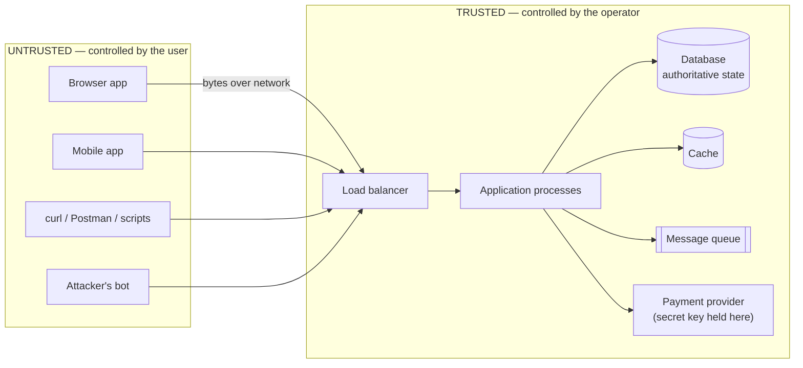
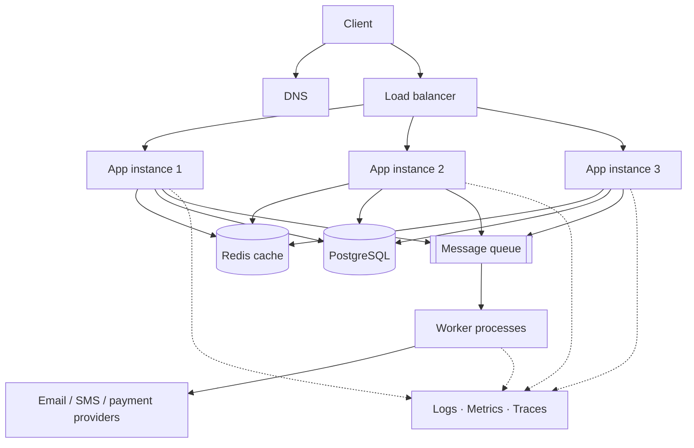
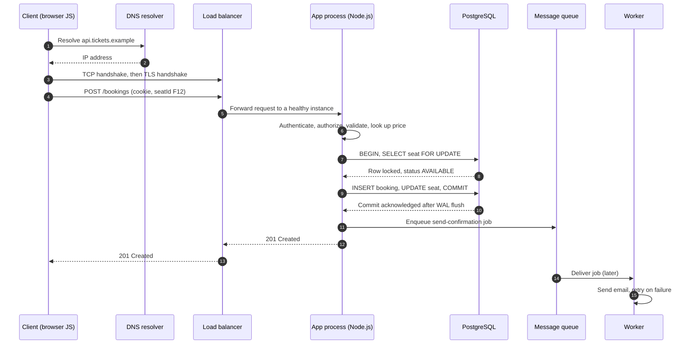
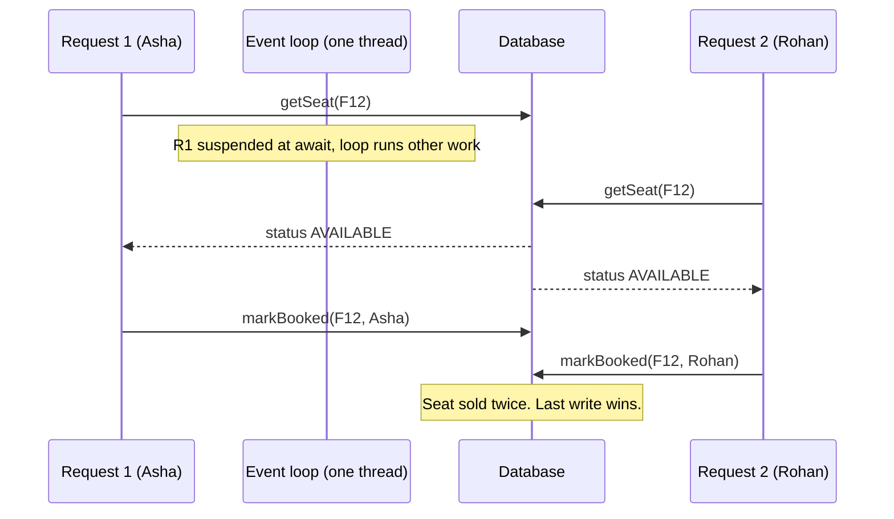
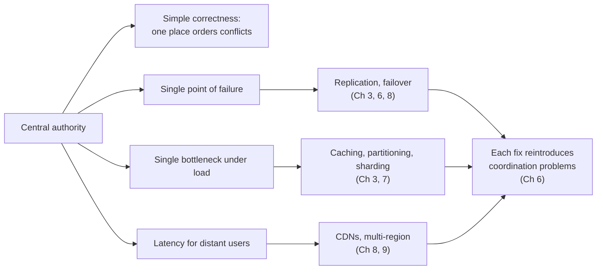

# What Is Backend Engineering?

> **Chapter 1 · Unit 1.1 · Tier: Standard**
> Prerequisites: none
> Next: [1.2 Client–Server Architecture and the Request–Response Model](./02-client-server-architecture.md)
> Interview questions: [Q1–Q16 in `interview-questions.md`](../interview-questions.md#unit-11--what-is-backend-engineering)

---

## Contents

1. [What it is](#1-what-it-is)
2. [Why it exists — the problem it solves](#2-why-it-exists--the-problem-it-solves)
3. [The trust boundary](#3-the-trust-boundary)
4. [Components of a production backend](#4-components-of-a-production-backend)
5. [Step-by-step walkthrough: one user action](#5-step-by-step-walkthrough-one-user-action)
6. [Backend development vs backend engineering](#6-backend-development-vs-backend-engineering)
7. [The four forces: how correct code becomes incorrect](#7-the-four-forces-how-correct-code-becomes-incorrect)
8. [System properties (non-functional requirements)](#8-system-properties-non-functional-requirements)
9. [Alternatives: when a backend is and is not required](#9-alternatives-when-a-backend-is-and-is-not-required)
10. [Trade-offs of a centralised backend](#10-trade-offs-of-a-centralised-backend)
11. [Common misconceptions](#11-common-misconceptions)
12. [Production relevance](#12-production-relevance)
13. [Experimental observations](#13-experimental-observations)
14. [Key terminology](#14-key-terminology)
15. [Interview angles](#15-interview-angles)

---

## 1. What It Is

**The backend** is the software and infrastructure that runs in an environment controlled by the system's operator. It holds the system's **authoritative state**, enforces its **rules**, keeps its **secrets**, and offers its capabilities to clients over a network.

**Backend engineering** is the discipline of designing, building and operating that system so it keeps the required properties (correctness, availability, performance, durability, security) while:

- many clients use it **concurrently**,
- components **fail** partially and unpredictably,
- **load** grows by orders of magnitude, and
- the code and infrastructure **change** continuously.

The distinction between these two definitions matters:

| | Concerned with |
|---|---|
| **Backend development** | Implementing functionality: endpoints, business logic, queries. |
| **Backend engineering** | Guaranteeing **system properties** of that functionality under concurrency, failure, scale and change. |

A handler that returns the right response for one request on a developer's machine is backend development. Making the same handler stay correct at 5,000 requests per second across several machines, through a database failover and a deploy, is backend engineering.

---

## 2. Why It Exists — the Problem It Solves

### 2.1 A system with no backend

Consider a ticket-booking application built purely as a client-side React app that stores all data in the browser's `localStorage`. It works for one user. In real use, it fails in six distinct ways:

| Situation | Failure | Underlying need |
|---|---|---|
| Two users on different devices both see seat F12 as available and both book it. | Each device has its own copy of the seat map; the copies diverge. Nothing has the authority to decide. | **A single source of truth that orders conflicting actions** |
| The client sends `price: 500`; a user edits the request to `price: 1`. | The client's code and requests can be modified. | **Rule enforcement in a trusted environment** |
| Charging a card requires the payment gateway's secret API key. | Anything shipped to the client can be extracted from it. | **A place to keep secrets** |
| A user's phone is destroyed. | The user's data existed only on that device. | **Durable storage independent of client devices** |
| A reminder email must go out at 09:00 on the event day. | No client may be running at that time. | **Execution that does not depend on a client being present** |
| Users search 50 million historical events. | The data set is too large to transfer to a client. | **Computation co-located with data** |

### 2.2 The fundamental reasons

| Reason | Explanation | Deep treatment |
|---|---|---|
| **Single source of truth and coordination** | When several actors change shared state, one authority must serialise conflicting operations. In a typical backend this authority is the database's concurrency control. | Ch 3 (transactions, locking), Ch 6 (consistency) |
| **Trusted rule enforcement** | Prices, permissions, quotas and business invariants hold only when enforced where clients cannot change the code. | Ch 2 (authentication, authorization, validation) |
| **Secret custody** | Credentials for databases, payment providers and signing keys must never leave operator-controlled machines. | Ch 4 (secrets management) |
| **Durability** | Data must survive device loss, process crashes and hardware failure. | Ch 3 (WAL, replication), Ch 8 (backups, DR) |
| **Client-independent execution** | Scheduled jobs, inbound webhooks from third parties, notification delivery, media processing. | Ch 4 (workers), Ch 7 (queues) |
| **Compute near data** | Queries over large data sets run where the data lives, and only results are sent back. | Ch 3, Ch 9 (search) |

---

## 3. The Trust Boundary

The precise line between frontend and backend is not "presentation vs logic". It is **who controls the execution environment**.



Consequences:

1. **Everything on the untrusted side is advisory.** Client-side validation exists for user experience (immediate feedback). It provides no security guarantee.
2. **Everything on the trusted side is authoritative.** The backend must independently validate every input, authorize every action, and derive every security- or money-relevant value (such as price) itself.
3. **The backend cannot identify the software that produced a request.** A client is any program that sends bytes to the server's address and port. A React app, `curl`, and a malicious script are indistinguishable at the protocol level. Authentication identifies the *principal* (user or service), never the *client software*.
4. **Secrets placed on the untrusted side are public.** Minification and obfuscation slow down extraction; they do not prevent it.

---

## 4. Components of a Production Backend

An application framework such as Express is one component among many.

| Component | Responsibility | Examples | Course chapter |
|---|---|---|---|
| **DNS** | Maps names (`api.tickets.example`) to IP addresses | Route 53, Cloudflare DNS | 1 |
| **Load balancer / reverse proxy** | Terminates client connections and TLS; distributes requests across healthy application instances | Nginx, HAProxy, cloud load balancers | 4, 8 |
| **Application server processes** | Execute application code: authentication, authorization, validation, business rules, orchestration of other components | Node.js + Express (multiple instances) | 1, 4 |
| **Database** | Stores authoritative state; enforces constraints; serialises concurrent writes; guarantees durability | PostgreSQL | 3 |
| **Cache** | Serves frequently read data from memory to reduce latency and database load | Redis | 7 |
| **Message queue / broker and workers** | Accept work immediately; execute it later, reliably, outside the request path | RabbitMQ, Kafka, worker processes | 7 |
| **Object storage** | Stores large binary objects (images, video, documents) | S3, Azure Blob Storage | 9 |
| **External services** | Payments, email, SMS, identity providers | Payment gateways, email APIs | 6, 11 |
| **Observability stack** | Collects logs, metrics and traces so engineers can understand system behaviour | Prometheus, Grafana, OpenTelemetry | 4, 8 |



---

## 5. Step-by-Step Walkthrough: One User Action

A user taps **"Book seat F12"**. Each step lists the component that performs it.



| # | Operation | Performed by | State involved | Unit / chapter |
|---|---|---|---|---|
| 1 | Construct `POST /bookings` containing the seat ID and the session cookie. No price is sent. | Client JavaScript | Session cookie in the browser | Ch 2 |
| 2 | Resolve `api.tickets.example` to an IP address, using caches at each level | OS stub resolver, recursive resolver, authoritative DNS servers | DNS caches (with TTLs) | 1.7 |
| 3 | Establish a TCP connection to port 443; perform the TLS handshake | Client OS kernel (TCP); browser TLS library | Kernel socket state on both ends | 1.8, Ch 2 |
| 4 | Accept the connection, terminate TLS, select a healthy application instance, forward the request | Load balancer | Health-check results; connection tables | Ch 4, Ch 8 |
| 5 | Accept the forwarded connection; signal readability; run middleware and handler | App host kernel → libuv → Node.js event loop → Express | Kernel accept queue; socket buffers | 1.11–1.13 |
| 6 | Authenticate the session, authorize the action, validate input, compute the price | Application code | Session store; pricing data | Ch 2 |
| 7 | Run a transaction that locks the seat row, inserts the booking, marks the seat booked and commits | Application (issues SQL over a pooled connection); **database lock manager** (serialises competing transactions); WAL writer (durability) | Seat and booking rows; row locks; write-ahead log | Ch 3 |
| 8 | Enqueue a confirmation-email job | Application → message broker | Queue contents | Ch 7 |
| 9 | Return `201 Created` through the load balancer | Application → load balancer → client | — | Ch 2 |
| 10 | Deliver the job; send the email; retry on failure | Broker → worker process → email provider | Job state; retry counters | Ch 7 |
| — | Emit a structured log line, increment metrics, record a trace span | Application and worker, via the observability stack | Log and metric storage | Ch 4 |

The SQL in step 7:

```sql
BEGIN;
SELECT status FROM seats WHERE id = 'F12' FOR UPDATE;   -- acquire row lock
-- application verifies status = 'AVAILABLE'
INSERT INTO bookings (seat_id, user_id, amount) VALUES ('F12', 42, 500);
UPDATE seats SET status = 'BOOKED' WHERE id = 'F12';
COMMIT;
```

**How the conflict is resolved.** If a second user's transaction reaches `SELECT … FOR UPDATE` on the same row while the first holds the lock, the database makes it wait. When the first commits, the second transaction reads the row's latest committed version, sees `BOOKED`, and the application rejects that booking. **The decision is made by the database's concurrency control, not by either client and not by the application's in-memory logic.** The mechanism is covered in Chapter 3 (locking, isolation, MVCC).

**When "committed" is true.** With default settings, PostgreSQL acknowledges a commit only after the transaction's WAL records are flushed to durable storage. A crash after the acknowledgement does not lose the booking (Chapter 3, WAL and crash recovery).

**Observation.** A single tap involves at least eight independent components: client, DNS, kernel network stacks, load balancer, runtime, application code, database and broker/worker. Backend engineering requires understanding each component **and how their interactions behave under concurrency and failure**.

---

## 6. Backend Development vs Backend Engineering

| Dimension | Developer machine | Production |
|---|---|---|
| Concurrent users | One | Thousands |
| Application processes | One | Many, across several machines |
| Database location | `localhost`, sub-millisecond, always reachable | Remote host; latency varies; can be slow or unreachable |
| Restarts | Free | Drop in-flight requests unless shutdown is graceful |
| Data | Disposable | Loss is an incident; must survive crashes |
| Errors | Visible in the terminal | One failure among millions of requests; must be found via logs, metrics and traces |
| Deployment | Save the file | Must cause no downtime and must be reversible |
| Input | Friendly | Adversarial |

None of the production conditions exist during typical local testing. This is why code that passes local tests can be incorrect in production.

---

## 7. The Four Forces: How Correct Code Becomes Incorrect

Four forces, plus adversarial input, expose defects invisible during single-user testing: **concurrency, failure, scale and change**.

### 7.1 A handler with four production defects

```js
const bookedBy = {};                                      // in-process memory

app.post('/book', async (req, res) => {
  const { seatId, price } = req.body;                     // (A)
  const seat = await db.getSeat(seatId);
  if (seat.status !== 'AVAILABLE')                        // (B) check ...
    return res.status(409).json({ error: 'taken' });

  await paymentGateway.charge(req.user.id, price);        // (C)
  await db.markBooked(seatId, req.user.id);               // (B) ... then act
  bookedBy[seatId] = req.user.id;                         // (D)
  res.json({ ok: true });
});
```

| Defect | Exposing force | Production failure | Correct approach | Chapter |
|---|---|---|---|---|
| **(A)** Price accepted from the client | Adversarial input | User pays an arbitrary amount | Derive the price on the server from authoritative data | Ch 2 |
| **(B)** Check-then-act as two separate operations | Concurrency | Two requests both observe `AVAILABLE` before either writes; the seat is sold twice | Make check and update atomic in the database (conditional update, row lock, or constraint) | Ch 3 |
| **(C)** External call with no timeout and no idempotency key; charge before booking | Failure | A hung gateway holds the request indefinitely; client retries cause double charges; if `markBooked` fails after the charge, the user pays without a seat | Timeouts, idempotency keys, correct ordering or compensation | Ch 6, Ch 9 |
| **(D)** State held in process memory | Scale and change | Each of N instances holds a different `bookedBy`; restarts and deploys erase it | Keep shared state in a shared, durable store | Unit 1.16 |

### 7.2 Why defect (B) occurs in single-threaded Node.js

Node.js executes JavaScript on one thread, but **requests interleave at every `await`**. When request 1 awaits `db.getSeat`, control returns to the event loop, which can run request 2's handler up to its own `await`. The sequence below is entirely possible on one thread:



**Single-threaded means only one piece of JavaScript executes at a time. It does not mean only one request is in progress at a time.** Race conditions arise between non-atomic *operations*, regardless of thread count. With multiple instances, the interleaving also happens across processes and machines, where no in-process lock could help. The mechanics of interleaving are covered in Units 1.12–1.14; the correct fixes in Chapter 3.

---

## 8. System Properties (Non-Functional Requirements)

System design is largely the practice of choosing which of these properties a system needs, at what level, and trading them against each other.

| Property | Question answered | Typical measure |
|---|---|---|
| **Latency** | How long does one operation take? | Percentiles: p50, p95, p99 (not averages; see Ch 6) |
| **Throughput** | How many operations per unit of time? | Requests/second, messages/second |
| **Availability** | What fraction of time does the system serve requests successfully? | Percentage of successful requests or of uptime |
| **Durability** | Once acknowledged as stored, can data be lost? | Probability of loss; RPO (Ch 8) |
| **Consistency** | Do readers observe the latest, agreed-upon state? | Consistency model (Ch 6) |
| **Scalability** | Can capacity grow by adding resources, and how efficiently? | Throughput gained per resource added |
| **Security** | Does the system resist adversarial use? | Threat model coverage |
| **Observability** | Can internal state be inferred from external outputs? | Coverage of logs, metrics, traces |
| **Maintainability** | Can engineers change the system safely and quickly? | Change failure rate, lead time |
| **Cost** | What does serving a request cost? | Cost per request / per user |

### 8.1 Availability arithmetic

Downtime allowed per year = (1 − availability) × time in a year (365 days = 8,760 h = 525,600 min).

| Availability | Calculation | Allowed downtime / year | Allowed downtime / 30-day month |
|---|---|---|---|
| 99% | 0.01 × 8,760 h | **87.6 h** | 7.2 h |
| 99.9% | 0.001 × 8,760 h | **8.76 h** | 43.2 min |
| 99.99% | 0.0001 × 525,600 min | **52.6 min** | 4.32 min |
| 99.999% | 0.00001 × 525,600 min | **5.26 min** | 25.9 s |

Each additional nine costs disproportionately more. At 99.99%, a single 10-minute incident consumes about 20% of the year's budget. Reaching it requires automated failover, redundancy across failure domains, and deployment practices that avoid downtime (Chapters 4 and 8).

---

## 9. Alternatives: When a Backend Is and Is Not Required

Three questions decide whether a custom backend is needed:

1. Is there **shared mutable state** that requires an authority?
2. Are there **rules that must hold** despite untrusted clients?
3. Are there **secrets** that clients must not possess?

| Approach | Where authority lives | Strengths | Weaknesses |
|---|---|---|---|
| **Local-only application** (calculator, offline editor) | The device | No infrastructure | No sharing, no cross-device durability |
| **Static site on a CDN** | No mutable state | Cheap, fast, highly available | No per-user state or rule enforcement |
| **Backend-as-a-Service** (Firebase, Supabase) | Vendor-operated backend; rules expressed as configuration | Very fast to build; operations handled by vendor | Limited control; complex logic hard to express; vendor lock-in |
| **Serverless functions** | Your code, in provider-managed processes | No server management; scales to zero | Cold starts, execution limits, connection-management difficulty (Ch 3 pooling) |
| **Peer-to-peer / blockchain** | No single authority; peers agree via protocol | No central point of control or failure | Agreement is slow, costly and complex (consensus, Ch 6) |
| **Local-first with sync** (CRDT-based) | Each device; a server relays and merges | Works offline; low perceived latency | Conflict resolution is difficult; some invariants cannot be enforced (Ch 6) |
| **Conventional backend** | Operator's servers and database | Simple, strongly consistent decisions; full control | The authority is a single point of failure and the bottleneck that must be scaled |

---

## 10. Trade-offs of a Centralised Backend



Centralising authority makes correctness simple and makes availability and scale hard. Most of this course is about keeping the correctness guarantees of a single authority while spreading that authority across many machines, and about understanding exactly which guarantees are weakened when that is not possible.

---

## 11. Common Misconceptions

| Misconception | Correction |
|---|---|
| "Backend engineering means writing APIs." | APIs are the entry point. Data modelling, concurrency control, asynchronous processing, infrastructure, failure handling and operations make up most of the work. |
| "Backend means a framework such as Express, Spring or Django." | A framework is one component of one tier. The engineering problems are independent of language and framework. |
| "Frontend validation makes backend validation unnecessary." | Clients are untrusted and replaceable. Only server-side enforcement provides guarantees. |
| "Node.js is single-threaded, so it cannot have race conditions." | Requests interleave at every `await`. Races occur between non-atomic operations, and across instances, regardless of thread count. |
| "Modern backends are stateless." | The **application tier** is typically stateless. The **system** is fundamentally stateful; state is moved into databases, caches and queues that are designed to manage it. |
| "Obfuscating a client app protects an embedded API key." | Anything delivered to a client can be extracted. Obfuscation only increases the effort. |
| "If it passes tests locally, it is correct." | Concurrency, partial failure, scale and adversarial input are usually absent from local testing. |

---

## 12. Production Relevance

Defects of the kinds in §7 appear in production as specific, recognisable symptoms:

| Symptom reported | Typical root cause class | Where to look first |
|---|---|---|
| "The same seat/item was sold twice" | Non-atomic check-then-act | Transaction boundaries; locking; unique constraints |
| "Customers were charged twice" | Retries of non-idempotent operations | Retry configuration; idempotency keys; gateway logs |
| "Users get logged out randomly after we added servers" | In-process session state across multiple instances | Where session state is stored; load-balancer routing |
| "Requests hang during a provider outage, then the whole service stops responding" | Missing timeouts; exhaustion of connections or concurrency | Outbound call timeouts; connection-pool metrics |
| "Prices in some orders are wrong" | Trusting client-supplied values | Request payload logs; server-side derivation logic |

Investigation relies on observability: structured logs with request identifiers, latency and error-rate metrics per endpoint and dependency, and traces across components (Chapter 4).

---

## 13. Experimental Observations

No experiment for this unit. The concurrency defect in §7.2 will be reproduced and measured in assignment A3.5 (Chapter 3).

---

## 14. Key Terminology

| Term | Definition |
|---|---|
| **Backend** | Operator-controlled software and infrastructure holding authoritative state, enforcing rules, keeping secrets, and serving clients over a network. |
| **Client** | Any program that sends requests to the backend. Its identity as software cannot be verified. |
| **Trust boundary** | The line between environments the operator controls and those it does not. All input crossing it must be treated as untrusted. |
| **Authoritative state** | The state the system treats as the truth, against which all conflicting views are resolved. |
| **Principal** | The identity (user or service) on whose behalf a request is made, established by authentication. |
| **Non-functional requirement** | A required property of the system's behaviour (latency, availability, durability, etc.) rather than a feature. |
| **Check-then-act race** | A defect where a condition is checked and then acted upon in separate, non-atomic steps, allowing another operation to invalidate the condition in between. |
| **Idempotent operation** | An operation that has the same effect whether performed once or several times (Ch 2, Ch 6). |
| **Single point of failure (SPOF)** | A component whose failure makes the whole system unavailable. |
| **Application tier** | The layer of processes running application code, typically designed to be stateless and horizontally replicated. |

---

## 15. Interview Angles

- Defining backend engineering by **trust, authority and system properties**, not by frameworks.
- Explaining **why server-side validation is mandatory**.
- Recognising that **single-threaded Node.js still has race conditions**.
- Explaining **where state goes** in a "stateless" architecture.
- Reviewing a handler and naming its **production failure modes** under concurrency, failure, scale and adversarial input.
- Reasoning about the **trade-offs of central authority** versus decentralised alternatives.

See [Q1–Q16](../interview-questions.md#unit-11--what-is-backend-engineering).
